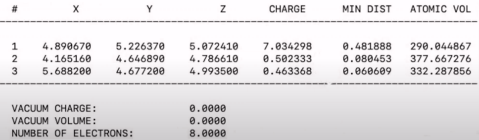
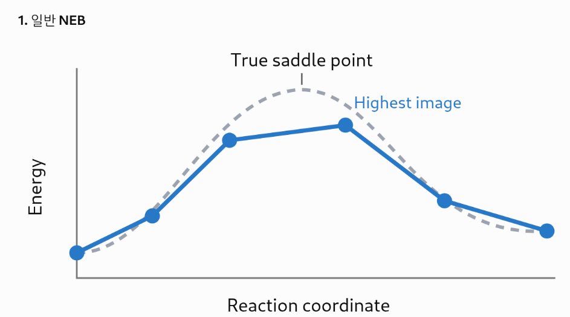
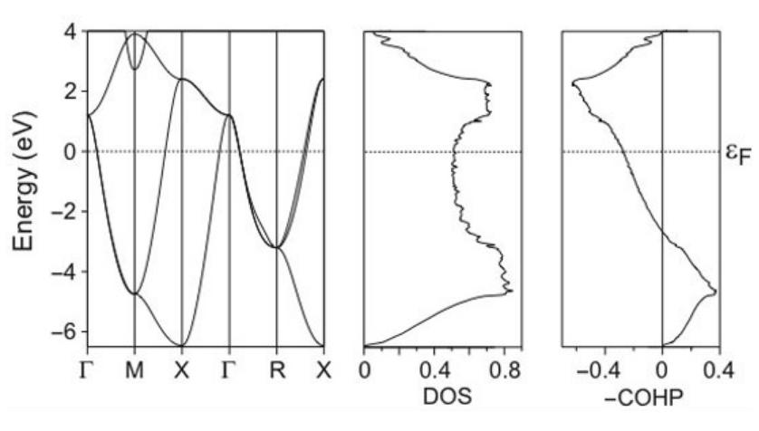
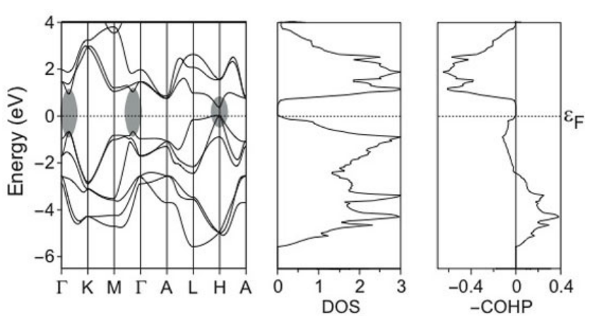

# VASP

## Contents

VASP

&#9;install + w. extension, Intel, GNU

&#9;Files(Input, Output)

&#9;DFT (hybrid) + Dispersion

&#9;MD

&#9;NNFF

&#9;NEB

&#9;Postprocess

&#9;&#9;Dos

&#9;&#9;Band

&#9;&#9;zpe

&#9;&#9;Charge density

&#9;Visualizer: py4vasp, P4vasp, vaspkit, XMgrace

&#9;surface SnO2,

<br>

## VASP (Vienna Ab-initio Package)

## Intel Install

### source files

- versions v6
    - kinds
        - 6.4.2: patchable
        - 6.4.3: not patchable
        - 6.5.0: newest released on 12/27/24
    - menu
        - manual: [https://www.vasp.at/wiki](<https://www.vasp.at/wiki>)
        - building: [https://www.vasp.at/wiki/index.php/Installing\_VASP.6.X.X](<https://www.vasp.at/wiki/index.php/Installing_VASP.6.X.X>)
        - support: [https://www.vasp.at/forum](<https://www.vasp.at/forum>)
            - building, using
        - homepage: [https://www.vasp.at](<https://www.vasp.at>)
            - license, news, download portal
- versions v5
    - vasp.5.4.4
        - only one tar of vasp.5.4.4.tar
    - vasp.5.3.5
        - vasp.5.3.5.tar&#9;&#9;! source for vasp
        - vasp.5.lib.tar
    - vasp extensions
        - vtst\_sh.tar
            - vtstcode + fftw3.f, main.F, zz-vtst.sh

### Intel compiler w. lib, fftw

- two binaries required
    - compiler: icc, icpc, ifort or newer icx, ifx
        - ` source ….sh intel64 `
        - version problem
            - Intel 2011-2013 is compatible with gcc 4.8, 5, 7
                - not compatible with 12.2
    - mkl library
    - impi: intel mpi binary
    - And env setup: PATH, LD\_LIBRARY\_PATH, etc
        - MKLROOT
- solve version conflict
    - Present: new gcc (g++-12) w. old icc (intel-2011)
    - Install g++-7, 4.8 which might be compatible with icc
    - Use Intel OneAPI (ipx)
        - OneAPI base (others C++ necessaties)
            - C++ lib, comp, MKL, Deep NN,
        - during installation: lack of / storage
            - In a few step, intel makes oneapi in /opt/intel
                - ` mv oneapi to home: sudo mv oneapi /home/joonho/intel `
                - ` make link: sudo ln -s /home/joonho/intel/oneapi oneapi `
            - setup can continue without lack storage error
- Intel structure
    - binary
        - $INTEL/version/linux/bin/intel64
        - $INTEL/version/linux/mpi/intel64/bin
    - mkllib
        - $MKLROOT/lib/intel64
    - fftw
        - headfiles: $MKLROOT/include/fftw
        - source: $MKLROOT/interface/
            - compile fftw and save $MKLROOT/lib/intel64
- Copying intel lib
    - copy a compiled intel compiler to /opt/intel
        - wrapper is required for variable
            - .bashrc
                - ` export I_ROOT=/opt/intel `
                - ` source ${I_ROOT}/Compiler/XE…/bin/compilervars.sh intel64 `
    - copy mkl
- compile Intel fftw
    - su -
    - ` source /opt/intel/…. sh `
    - ` cd $MKLROOT/interfaces `
    - compile in each directory
        - ` cd fftw3xf `
            - ` make : shows option `
            - ` make libintel64 `
            - copy libfftw…. to $MKLROOT/lib/intel64
- intel lib
    - general source file
        - one script way
            - ` source /opt/intel/psxevars.csh `
        - two scripts way
            - ` source /opt/intel/version/bin/compilervars.csh intel64 `
            - ` source /opt/intel/version/mkl/bin/mklvars.csh intel64 `
        - e.g. 2017
            - bin/compilervars.csh intel64
            - mkl/bin/mklvars.csh intel64
    - all the MPI env variables are set automatically by intel
        - ` setenv MPICH_HOME /….. (OpenMPI library directory) `
            - OpenMPI was installed by intel sources
        - ` setenv PATH $MPICH_HOME/bin:$PATH `
        - ` setenv MANPATH $MPICH_HOME/man:$MANPATH `
        - ` setenv LD_LIBRARY_PATH $MPICH_HOME/lib:$LD_LIBRARY_PATH `
            - new LD\_LIBRARY\_PATH $MPICH\_HOME/lib:/usr/lib64:$MPICH\_HOME/include:$LD\_LIBRARY\_PATH

### OneAPI - intel

- Newest version of Intel compliler.
    - Need to OneAPI Basic for C++: icx, mpiicx, mpiifort
    - And fortran essential for Fortran: ifx
- Download
    - install Intel OneAPI from  [https://www.intel.com/content/www/us/en/developer/tools/oneapi/toolkits.html#gs.mpp7xi](<https://www.intel.com/content/www/us/en/developer/tools/oneapi/toolkits.html>)
- installation guide
    - [https://www.intel.com/content/www/us/en/docs/oneapi-base-toolkit/get-started-guide-linux/2025-1/before-you-begin.html](<https://www.intel.com/content/www/us/en/docs/oneapi-base-toolkit/get-started-guide-linux/2025-1/before-you-begin.html>)
- Configure
    - set up basic tools for linux
        - ` sudo apt update `
        - ` sudo apt -y install cmake pkg-config build-essential `
        - check
            - ` which cmake pkg-config make gcc g++ `
    - ` source setvars.sh once per session including mkl `
        - . /opt/intel/oneapi/setvars.sh
    - check up compilers
        - ` which icx mpiicx mpiifort `
        - Fortran essential  ifx
    - compiler
        - icx for C
        - icpx for C++
        - ifx for Fortran
        - mpiicc ?= mpiicx, mpiicpx for mpi C & C++
        - mpiifx, mpiifort for mpi fortran
- Build and run a sample

### OpenMPI

- general
    - cf. /scratch/joonho/compile\_class/qcextlibs
    - home: /openmpi-2.0.2
- ` mkdir ../openmpi		! mpi_home `
    - ` make directory for lib or bin in advance `
- ` ./configure CC=icc CXX=icpc F77=ifort FC=ifort --prefix=/qcfs/joonho/compile_class/qcextlibs/openmpi –enable-static `
    - icc = intel C-compiler
    - icpc = intel cpp compiler
    - ifort = ifortran
    - --prefix=/dir to store library (= mpi home)
    - --enable-static: to combine ext-library into openmpi
- make
- ` make install `
    - install library into dir of –prefix
- overall
    - intel serves scalarpack, openblac, blas in mkl
    - Openmpi\_fcc, openmpi\_f90 will run based on the OpenMPI and ifort, icc
    - ` mpirun –version: for version check `
    - in “./configure CC=icc” it runs icc run by .tcshrc.rho.env
- for gnu
    - scalapack, openblas

### Install VASP

- V.6 at Pt/Au
    - update to 6.4.2 - 2024.12
    - modules
        - ` module add compiler/2023.1.0 `
        - ` module add mkl/2023.1.0 `
        - ` module add mpi/2021.12.1 `
        - ` module add VASP/basic_tools `
    - ` module home `
        - /TGM/Apps/VASP/VASP\_BIN/
    - directory division for cpu spec
        - AVX512
            - X1: Normal
            - X2: AVX
            - X3: AVX2
            - X4 ~ X6: AVX512
        - check avx
            - ` ssh node `
            - ` vim /proc/cpuinfo `
                - ` grep avx `
    - execution file
        - BEEF: Bayesian error estimation
            - [https://journals.aps.org/prb/abstract/10.1103/PhysRevB.85.235149](<https://journals.aps.org/prb/abstract/10.1103/PhysRevB.85.235149>)
                - by Norskov (ASE)
        - DFT4
        - VASPSOL: VASPSOL++(vaspsolPP)
            - [https://github.com/VASPsol/VASPsol](<https://github.com/VASPsol/VASPsol>)
        - vtst - for NEB
- V.6 at KISTI
    - ` module 설정 `
        - ```text
            $ module purge
            $ module load intel/19.1.2 impi/19.1.2 cmake/3.26.2
            ```
    - file
        - ` cp ./arch/makefile.include.intel makefile.include `
    - ` vi makefile.include `
        - ```text
            ADDITIONAL_OPTS=-O3 -qopenmp -xCOMMON-AVX512 -align array64byte
            ADDITIONAL_OPTS_CC=-O3 -qopenmp -xCOMMON-AVX512
            
            CPP_OPTIONS = -DHOST=\"LinuxIFC\" \
            -DMPI -DMPI_BLOCK=8000 -Duse_collective \
            -DscaLAPACK \
            -DCACHE_SIZE=12000 \
            -Davoidalloc \
            -Dvasp6 \
            -Duse_bse_te \
            -Dtbdyn \
            -Dfock_dblbuf \
            -D_OPENMP \
            -Dsol_compat
            
            CPP = fpp -f_com=no -free -w0 $*$(FUFFIX) $*$(SUFFIX) $(CPP_OPTIONS)
            
            FC = mpiifort -qopenmp -mkl=parallel ${ADDITIONAL_OPTS}
            FCL = mpiifort -mkl=parallel ${ADDITIONAL_OPTS}
            
            FREE = -free -names lowercase
            
            FFLAGS = -assume byterecl -w
            
            OFLAG = -O3 -fPIC -align array64byte
            OFLAG_IN = $(OFLAG)
            DEBUG = -O0
            
            OBJECTS = fftmpiw.o fftmpi_map.o fftw3d.o fft3dlib.o
            OBJECTS_O1 += fftw3d.o fftmpi.o fftmpiw.o
            OBJECTS_O2 += fft3dlib.o
            
            CPP_LIB = $(CPP)
            FC_LIB = $(FC)
            CC_LIB = icc
            CFLAGS_LIB = -O
            FFLAGS_LIB = -O1
            FREE_LIB = $(FREE)
            
            OBJECTS_LIB = linpack_double.o
            
            CXX_PARS = icpc
            LLIBS = -lstdc++
            
            VASP_TARGET_CPU ?= -xCOMMON-AVX512
            FFLAGS += $(VASP_TARGET_CPU)
            
            FCL += -mkl=sequential
            MKLROOT = /apps/compiler/intel/19.1.2/mkl
            LLIBS += -L$(MKLROOT)/lib/intel64 -lmkl_scalapack_lp64 -lmkl_blacs_intelmpi_lp64
            INCS =-I$(MKLROOT)/include/fftw
            
            ====== vi 편집기 ======
            ```
    - ` $ make DEPS=1 all `
- V.5
    - general
        - [https://linuxcluster.wordpress.com/2014/09/29/compiling-vasp-5-3-5-with-openmpi-1-6-5-and-intel-12-1-5/](<https://linuxcluster.wordpress.com/2014/09/29/compiling-vasp-5-3-5-with-openmpi-1-6-5-and-intel-12-1-5/>)
        - compile using OpenMPI
    - in vasp library directory
        - ` cd ~/vasp.5.lib `
        - use linux\_ifc\_P4
            - ` cp makefile.linux_ifc_P4 Makefile `
        - modify Makefile
            - ` FC=ifort			! without mpi `
        - make
            - makes libdmy.a
    - in vasp directory
        - ` cd ~/vasp.5.3 `
        - use linux\_ifc\_P4
            - ` cp makefile.linux_ifc_P4 Makefile `
        - Makefile correction
            - ` MKLROOT=/opt/intel/…./mkl `
                - up to /mkl
                - confer env file
            - ` FC=/scratch/…/openmpi/bin/mpiifort		! or mpif90 `
                - mpif90 located on dir of OpenMPI
            - ` LIB = -L../vasp.5.lib –ldmy \ ../vasp.5.lib/linpack_double.o $(LAPACK) *(BLAS) `
                - modify by vasp.lib
            - ` FCL=$(FC) –mkl `
            - ` BLAS= -mkl=sequential `
    - patch VTST
    - patch VASPsol
    - make
        - ` make vasp `
            - vasp
- vasp 5.4.4
    - reference
        - http://cms.mpi.univie.ac.at/wiki/index.php/Installing\_VASP
            - pre-requisite
                - lapack, scalapack, openmpi, fftw
        - KISTI - Nurion
            - [https://blog.ksc.re.kr/98](<https://blog.ksc.re.kr/98>)
            - README on VASP
    - structure and build&#9;cf. makefile.include
        - structure
            - root/
                - makefile
            - root/src
            - root/src/lib
                - VASP library once used to be vasp.X.lib
            - root/src/parser
                - v \>= 5.4.4
            - root/src/CUDA
                - GPU port of VASP
            - root/arch
                - makefile.include.arch files
            - root/build
                - different version of VASP such as standard(std), gamma-only(gam), non-collinear(ncl)
                - in recompile
                    - remove all the files inside /build leaving /build itself
            - root/bin
                - store binaries
        - ` make options `
            - std gam ncl gpu gpu\_ncl
        - command
            - ` cp root/arch/makefile.include.linux_intel root/makefile.include `
            - ` make all `
            - or one by one
                - ` make std `
                - ` make gam `
                - ` make ncl `
    - requisite for installation
        - prepare different makefile.include
        - debian prerequisite (linux-gnu)
            - [http://cms.mpi.univie.ac.at/wiki/index.php/A\_Debian\_based\_installation\_of\_VASP](<http://cms.mpi.univie.ac.at/wiki/index.php/A_Debian_based_installation_of_VASP>)
            - ` apt-get install libblas-dev liblapack-dev libopenmpi-dev libscalapack-mpi-dev libscalapack-openmpi1 libfftw3-dev `
                - for LAPACK, SCALAPACK, OpenMPI, FFTW
            - copy Makefile.include
        - psi prerequisite (linux-intel)
            - mkl
    - makefiles.include
        - prepare makefile.include from /arch/makefile.include.linux\_intel
        - makefile loop
            - "make option” run Makefile
                - ` mkdir build/option `
                - ` cp src/makefile makefile.include to build/option `
                - run build/option/makefile
            - build/option/makefile
                - include .objects makefile.include
        - makefiles.include
            - Nurion
                - ` ADDITIONAL_OPTS=-O3 -qopenmp -xMIC-AVX512 -align array64byte `
                - ` ADDITIONAL_OPTS_CC=-O3 -qopenmp -xMIC-AVX512 `
            - ` CPP_OPTIONS= -DHOST=\"IFC15_impi\"\ `
            - -DMPI -DMPI\_BLOCK=8000 \\
            - -Duse\_collective \\
            - -DCACHE\_SIZE=12000 \\
            - -Davoidalloc \\
            - -DnoAugXCmeta \\
            - -Duse\_bse\_te \\
            - -Dtbdyn \\
            - -Dvasp6 \\ &#9;&#9;# related to error USE us, only:
            - -D\_OPENMP -DPROFILING -Duse\_shmem \\
            - -Dshmem\_bcast\_buffer -Dsheme\_rproj&#9;
            - ` CPP        = fpp -f_com=no -free -w0  $*$(FUFFIX) $*$(SUFFIX) $(CPP_OPTIONS) `
            - ` FC         = mpiifort -O3 -qopenmp -mkl=parallel ${ ADDITIONAL_OPTS} `
            - ` FCL        = mpiifort -O3 -qopenmp -mkl=parallel ${ ADDITIONAL_OPTS} `
            - ` FREE       = -free -names lowercase `
            - ` FFLAGS     = -assume byterecl `
            - ` OFLAG      = ${ADDITIONAL_OPTS} `
            - ` OFLAG_IN   = $(OFLAG) `
            - ` DEBUG      = -O0 `
            - ` MKL_PATH   = $(MKLROOT)/lib/intel64 `
            - ` OBJECTS    = fftmpiw.o fftmpi_map.o fft3dlib.o fftw3d.o `
            - ` INCS       =-I$(MKLROOT)/include/fftw `
            - ` OBJECTS_O1 += fft3dfurth.o fftw3d.o fftmpi.o fftmpiw.o `
            - ` OBJECTS_O2 += fft3dlib.o `
    - VTST
        - modify src/.objects
            - include vtst object files in .objects file
        - ./zz-vtst.sh
            - copy vtst source code to /src
        - tweak
            - copy bbm.F us.F from v.5.3.5
                - bbm.F
                    - diff vasp5.3/bbm.F vasp.5.4.1/src/bbm.F
                        - remove \<NABS\>
                - error
                    - USE us, only : setdij\_
            - ` mv “#if defined” to 1st column in dimer.F `
    - VASPsol
        - include solution.F in /src, it will be automatically compiled
        - [https://www.vasp.at/info/resource/](<https://www.vasp.at/info/resource/>)
            - Include implicit solvent model
        - Usage
    - MD package
- vasp 5.3.5 - chi
    - structure
        - vasp 5.3.5 & vasplib
    - /vasplib
        - modify makefile.linux\_ifc\_P4
            - ` FC=ifort `
        - ` make -f makefile.linux_ifc_P4 `
            - makes “libdmy.a”
    - /vasp 5.3
        - makefile in KISTI-Nurion # the same in chi (error -\> comment vasp6)
            - ` FC=mpiifort `
            - ` CPP_=fpp -f_com=no -free -w0 $*.F $*$(SUFFIX) `
            - ` CPP     = $(CPP_) -DMPI -DHOST=\"LinuxIFC\" -DIFC \ `
            - -DCACHE\_SIZE=16000 -DPGF90 -Davoidalloc -DNGZhalf \\
            - -DMPI\_BLOCK=8000 -Duse\_collective \\
            - -DRPROMU\_DGEMV  -DRACCMU\_DGEMV
            - ` FFLAGS =  -FR -assume byterecl `
            - ` OFLAG=-O3 -ip -ftz -xCORE-AVX2 `
            - ` MKL_PATH=$(MKLROOT)/lib/intel64 `
            - ` MKL_FFTW_PATH=$(MKLROOT)/interfaces/fftw3xf/ `
                - is this right? use $(MKLROOT)/lib/intel64
            - ` BLAS= -mkl=cluster `
            - ` LIB  = -L../vasp.5.lib -ldmy \ `
            - ../vasp.5.lib/linpack\_double.o
            - ` LINK = -shared-intel `
            - ` FFT3D   = fftmpiw.o fftmpi_map.o fftw3d.o fft3dlib.o  \ `
            - $(MKLROOT)/lib/intel64/libfftw3xf\_intel.a
            - ` INCS = -I$(MKLROOT)/include/fftw `
        - make
            - makes vasp

### compile error

- USE solvation: error in opening the compiled module
    - missing object files in makefile
        - solvation.o should locate before pot.o
        - vtst
- v.5.3.5
    - USE only error with vtst
        - us.F
            - USE us, only: setdij\_&#9;: Name in only-list does not exist or is not accessible
        - clean version
            - compiled
    - make: \*\*\* No rule to make target \`/lib/intel64/libfftw3xf\_intel.a', needed by \`vasp'. Stop
        - try to write something on root
        - because could not find libfftw3xf\_intel.a
            - check path setting to libfftw3xf\_intel.a
            - check $MKLHOME&#9;cf. confirm lib in the path
- v5.4.1 clean version - chi
    - vasp6 error
        - #ifdef vasp6
            - chi.F
                - USE rpax
                    - no rpax!!!
            - main.F
                - USE greens\_real\_space
                - USE greens\_
                - USE time\_propgation
        - include -Dvasp6 in CPP

### run

- psi
    - ` MPI=”/opt/intel/impi/5.03..049/intel64/bin/mpirun –n $NPROC –machinefile $PBS_NODEFILE” `
    - ` EXEC=”<path/to/vasp/bin>/vasp-std” `
    - $MPI $EXEC \>\> $log\_dir/$jobname.log
- “mpirun –n 4 vasp” at node

### refer to VASP

- for the code , please cite
- \[1\] G. Kresse and J. Hafner, Phys. Rev. B 47 , 558 (1993); ibid. 49 , 14 251 (1994).
- \[2\] G. Kresse and J. Furthmuller, Comput. Mat. Sci. 6 , 15 (1996).
- \[3\] G. Kresse and J. Furthmuller, Phys. Rev. B 54 , 11 169 (1996).
- Pseudo Potential
    - GGA
        - Where appropriate, the use of the data-base on ultrasoft pseudopotentials should be referenced as
        - GGA: \[4\] G. Kresse and J. Hafner, J. Phys.: Condens. Matt. 6, 8245 (1994).
    - PAW
        - If the PAW-version is used, an additional reference should be made to
        - \[5\] G. Kresse and D. Joubert, Phys. Rev. 59 , 1758 (1999)
- D3 correction
    - \{Grimme, 2011 #9\}.

## Install options

### VTST

- cf. [http://theory.cm.utexas.edu/vtsttools/installation.html](<http://theory.cm.utexas.edu/vtsttools/installation.html>)
    - NEB, dimer, Lanczos, dynamical matrix methods, …
    - Henkelman Group
        - Code
            - vtsttools/
                - bader,
            - eon
            - tsase
- looks not working for 5.4
- download
    - script and vtsttools
        - all components
            - main.F
            - fftw3.f
            - /vtsttools
    - vtsttools/source into source directory
        - chain.F is replaced
        - neb.F, dynmat.F, dimer.F, lanczos.F, sd.F, sg.F, qm.F, lbfgs.F, bfgs.F, fire.F, opt.F
- modify Makefile variable SOURCE
    - ` mv chain.F chain.F.old 	! the original file `
    - in SOURCE, before chain.o
        - bfgs.o dynmat.o instanton.o lbfgs.o sd.o cg.o dimer.o bbm.o fire.o lanczos.o neb.o qm.o opt.o chain.o&#9;&#9;! copy this line
            - rule
                - dynmat.o neb.o dimer.o lanczos.o instanton.o before chain.o
                - sd.o, cg.o, qm.o, lbfgs.o, bfgs.o, fire.o before opt.o
    - chain.F
        - ` ICHAIN=0: Nudged elastic band (default) `
        - ` ICHAIN=1: Dynamical matrix `
        - ` ICHAIN=2: Dimer `
        - ` ICHAIN=3: Lanczos `
    - error and tweaks
        - no neb module
            - include neb.o etc of /vtst in Makefile
        - in case: fftmpiw.f90:70: Error: Can't open included file 'fftw3.f'
            - ` cp /usr/include/fftw3.f . `

### patch VASPsol

- whatitis
    - tutorial
        - https://wiki.bnl.gov/CFN-Computation/images/9/95/Tutorial7.pdf
- vasp.5.3
    - download [https://github.com/henniggroup/VASPsol](<https://github.com/henniggroup/VASPsol>)
        - interface\_patch\_533
        - solvation.F
    - in vasp\_source/
        - patch –p1 \< /…./interface\_patch\_533
        - ` cp solvation.F . `
        - correct Makefile
            - insert solvation.o in front of pot.o

### Wannier for GW

- package for bandgap
    - [http://www.wannier.org/](<http://www.wannier.org/>)
    - download and install wannier
- vasp compile
    - with flag: -DVASP2WANNIER90
- modify makefile
    - ` LIB     = -L../vasp.5.lib -ldmy  \ `
        - ../vasp.5.lib/linpack\_double.o ../wannier90-1.2/libwannier.a $(SCA) $(LAPACK) $(BLAS)

### constraint(z,xy)-relaxation

- cell relaxation to a certain direction, cf. constraint relaxation
    - constr\_cell\_relax.F
        - not control parameters in INCAR or POSCAR
            - set the stress tensor 0 inside source code then compile
        - only z-relax
            - save = fcell(3,3)
            - fcell=0
            - fcell(3,3) = save
        - in case xy-relaxation
            - fcell(1,3)=0
            - fcell(2,3)=0
            - fcell(3,3)=0
            - fcell(3,1)=0
            - fcell(3,2)=0
- gamma calculation
    - Also, there are "...vasp-...-gamma" executable files that can be used for gamma-point-only calculations. They provide around 10~50% enhanced performance compared to the "...-half" version, but the charge density is not available.
    - easily compiled in 5.4

### AIMD NVT

- default is NVE&#9;&#9;&#9;&#9;&#9;cf. AIMD
- compile with option
    - (Jinwoo Park, Pt)
        - ` CPP_OPTIONS= -DHOST=\"T2N\"\ `
        - -DMPI -DMPI\_BLOCK=8000 \\
        - -Duse\_collective \\
        - -DscaLAPACK \\
        - -DCACHE\_SIZE=4000 \\
        - -Davoidalloc \\
        - -Duse\_bse\_te \\
        - -Dtbdyn \\
        - -Duse\_shmem
    - (old)
        - ` CPP = $(CPP_) -DHOST=\"IFC9_fftw\" \ `
        - -Dkind8 -DNGXhalf -DCACHE\_SIZE=12000 -DPGF90 -Davoidalloc  \\
        - -Dtbdyn

## GNU Install - debian

### build vasp 5.3.5 using GNU compiler on Ubunto 14.04

- [http://www.ivofilot.nl/posts/view/28/How+to+build+VASP+5.3.5+using+the+GNU+compiler+on+Linux+Ubuntu+14.04+LTS#step1](<http://www.ivofilot.nl/posts/view/28/How+to+build+VASP+5.3.5+using+the+GNU+compiler+on+Linux+Ubuntu+14.04+LTS>)
    - works for Debian 8 also
    - for different version of vasp
        - cf. link on the website
- now install in Debian 10.4
- vasp recommend using ifort 11.1 not gfortran
- ` source 5.4 `
    - /qcfs/jackjack5/3party-software/vasp

### 4 steps in install

- installing the necessary packages including OpenMPI
- building OpenBLAS&#9;&#9;(based on OpenMPI)
- building ScaLAPACK&#9;&#9;(based on OpenMPI)
- building VASP

### prerequisite

- compiler
    - GCC for C, C++, Fortran, and other tools
        - GCC is an acronym for GNU Compiler Collection
    - how to know what compilers are installed?
        - dpkg –list \| grep compiler

### building steps for package

- step1: installing the necessary packages
    - ` apt-get install `
        - build-essential gfortran libopenmpi-dev libopenmpi1.6 openmpi1.6 libfftw3-double3 libfftw3-single3 libfftw3-dev git
- step2: building OpenBLAS
    - assume
        - everything is compiled in its own build directory
        - for convenience, declare a variable to build path
            - ` export BUILDPATH=$HOME/vaspbuild `
            - ` mkdir $BUILDPATH `
            - ` cd $BUILDPATH `
    - download
        - ` git clone https://github.com/xianyi/OpenBLAS.git --depth 1 `
            - this makes OpenBLAS directory in $BUILDPATH
    - make
        - ` cd $BUILDPATH/OpenBLAS `
        - ` make FC=gfortran CC=gcc USE_THREAD=0 `
            - output
                - OpenBLAS build complete (BLAS CBLAS LAPACK LAPACKE)
            - will make libopenblas.a
                - this will be used for compilation of scaLAPACK and VASP
- step3: building ScaLAPACK
    - download
        - ` cd $BUILDPATH `
        - ` wget http://www.netlib.org/scalapack/scalapack-2.0.2.tgz `
        - ` tar –xvzf scalapack-2.0.2.tgz `
        - ` cd $BUILDPATH/scalapack-2.0.2 `
        - ` cp SLmake.inc.example SLmake.inc `
    - modification of SLmake.inc
        - to use OpenBLAS
        - BLASLIB - -L/home/joonho/vaspbuild/OpenBLAS –lopenblas
        - ` LAPACKLIB = $(BLASLIB) `
            - to use lapack in openblas
    - make
        - generate libscalapack.a
        - there are so many warnings for type mismatch between fucntions

### building steps for vasp

- step4-1: build vasp lib
    - prepare two vasp packages
        - vasp5.tar.gz, vasp5.lib.tar.gz
    - compile vasp5.lib
        - ` cd vasp.5.lib `
        - ` cp makefile.linux_gfortran Makefile `
        - make
            - creating libdmy.a
- step4-2: compile vasp.5.3
    - some points
        - there are many tweaks
            - patch us.f90
        - include vtst files
        - include VASPsol
    - ` cp makefile.linux_gfortran Makefile `
    - ` vi Makefile `
        - remove “-C” from CPP line
            - ` CPP_= ./preprocess <$*.F | /usr/bin/cpp –P “-C” –traditional >$*$(S... `
        - comment the last line of fpp block
            - # CPP\_=fpp –f\_com=no –free –w0 $\*.F $\*$(SUFFIX)
        - change FFLAGS
            - ` FFLAGS =-ffree-form –ffree-line-length-0 `
                - note there is space after 0(zero)
        - down to MPI section
        - uncomment FC and FCL and change
            - ` FC=mpif90 `
            - ` FCL=$(FC) `
        - uncomment whole block of CPP and add –DMPI and –DscaLAPACK
        - use our scalapack
            - ` BUILDPATH=$(HOME)/ `
            - SCA
            - BLAS
            - LAPACK
        - include \*.o of /vtst in SOURCE
            - note the position of \*.o of /vtst
    - overload files
        - cf. vtst
        - main.F
        - fftw3.f
    - error and tweaks
        - no neb module
            - include neb.o etc of /vtst in Makefile
        - WRITE(    \<   \> ) in bbm.f90
            - rm bbm.f90
            - remove \<…\> part in bbm.F
        - USE us
            - ` wget http://www.ivofilot.nl/downloads/vasp535.patch `
            - patch -p0 \< vasp535.patch
        - in case: fftmpiw.f90:70: Error: Can't open included file 'fftw3.f'
            - ` cp /usr/include/fftw3.f . `
        - $make again whenever fix the error

## Machine environment

### running in console

- ` mpirun –np 4 vasp `

### submit PBS

- cpvaspall.sh
    - it detects server
    - makes vsp\_all.sh
    - vsp\_all.sh
- old fixed style
    - Psi: pbs-psi-vasp.sh
        - set MPI = "/opt/mpi/intel-12.1.6/openmpi-1.6.3/bin/mpirun -np $NPROC -hostfile $PBS\_NODEFILE"
            - set EXEC = "/opt/applic/vasp/bin/vasp-5.3.3-xe11-static-openmpi-1.6.3- TYPE”
                - ` TYPE= full, half, gamma `
            - ` setenv LD_LIBRARY_PATH  /opt/intel/composer_xe_2011_sp1.13.367/compiler/lib/intel64:/opt/intel/composer_xe_2011_sp1.13.367/mkl/lib/intel64:/opt/mpi/intel-12.1.6/openmpi-1.6.3/lib:$LD_LIBRARY_PATH `
        - directory
            - /opt/applic/vasp/pp’s
            - /opt/applic/vasp/bin/execution files
    - pbs-rho-vasp.sh
        - set MPI = "/opt/mpi/intel-12/openmpi-1.8.1/bin/mpirun -np $NPROC -hostfile $PBS\_NODEFILE"
        - ` EXEC="/opt/applic/vasp/bin/vasp-5.3.3-if12-openmpi-1.8.1-full" `
    - Kdft
        - Pbs
            - Pbs-kdft.csh
            - set MPI = "/opt/intel/Compiler/composer\_xe\_2011\_sp1.13.367/mpi/openmpi-1.6.3/bin/ mpirun -np $NPROC -hostfile $PBS\_NODEFILE"
            - set EXEC = "/opt/applic/vasp/bin/vasp-5.3.3-xe11-static-openmpi-1.6.3-TYPE"
            - ` setenv LD_LIBRARY_PATH /opt/intel/Compiler/composer_xe_2011_sp1.13.367/compiler /lib/intel64:/opt/intel/Compiler/composer_xe_2011_sp1.13.367/mkl/lib/intel64:/opt/intel/Compiler/composer_xe_2011_sp1.13.367/mpi/openmpi-1.6.3/lib:$LD_LIBRARY_PATH `
    - Platinum(jiil choi)
        - platinum.kaist.ac.kr//jeelc/emu0707
        - architecture
            - WEST: ppn=8, xbo1~30
            - EAST: ppn=12, xbo31~52
        - ftp
            - scp –p 1234 filename jeelc@platinum...
        - pbs
            - pestat
            - pbsfile
                - EXEBIN for vasp execution file
                    - Gamma, normal
        - Inner ftp
            - fget

### PP location

- PP: pseudo potential
    - /qcfs/common/vasp-pp
- Old
    - potpaw\_PBE
- new
    - newpot\_PBE

|  | Old pp | New pp |
| --- | --- | --- |
| decimal | .001 | 0.001 |
| option | QCUT, QGAM | RDEPT |
| New style |  | Atomic configuration |
|  |  |  |
|  |  |  |

- in case of POTCAR.Z
    - zcat POTCAR.Na.gz
        - zcat shows zipped file such as cat for text file not writing a new file
        - gunzip POTCAR.Na.gz
            - change file into POTCAR.Na
        - POTCAR.Z \> POTCAR
- scripts
    - bgf2pos.py name.bgf&#9;&#9;# generates name.pos
        - potgenerate\_pbe name.pos &#9;# generates name.pot
        - this reads 1<sup>st</sup> line of name.pos which should be atom list

## Input files

### POSCAR

- format
    - atom list&#9;&#9; read from ASE
    - lattice vector
    - \[atom list\] optional
    - number of ions per species following POTCAR
    - Selective dynamics \[s, S\] : optional for constraint MD
    - Cartesian or direct&#9;\[MD option is optional, T T F\]
    - position&#9;&#9;&#9;# T T T/F F F for (not)fixed constraint in MD
    - C, c, K, k or empty line for Cartesian scale of velocity  others, direct
        - direct: direct lattice vector/timestep
        - cartesian: Å/fs
    - velocity
        - No velocity  Temp will assign initial velocity randomly
        - if velocity  Temp is not working, the velocity will be used at first
            - N.B. if velocity == 0, Temp will not work at first
    - for 2<sup>nd</sup> and 3<sup>rd</sup> block for velocity and predict, refer to CONTCAR
- How to make POSCAR
    - Material project
        - materialproject.org
            - download cif
        - vesta
            - cif  POSCAR
    - msi2pos
        - MS  .msi  msi2pos.pl
            - save as POSCAR.blabla to be read in ASE
    - vesta
        - after VASP calculation
            - draw in vesta
        - not necessary to convert it to cif to be read in MS
            - CONTCAR  pos2cif.pl

### POTCAR

- PP should be installed
    - cf. PP\_Location
- different PPs
    - PAW
        - /pawGGA
        - /pawLDA&#9;&#9;&#9;# Need to load LDA PP for LDA calc
        - /paw\_pbe
    - POT
        - /pot\_GGA
        - /pot\_LDA&#9;&#9;&#9;# Need to load LDA PP for LDA calc
- format
    - Head
        - pre part
            - title…
            - valence charge
        - dict part
            - TiTEL title
            - ` LEXCH	= PE	# exchange correlation functional `
            - ` ZVAL	= 6	# number of valence charge `
        - Atomic configuration
            - n entries
            - n &#9;l &#9;j=\|l+s\|&#9;&#9;E&#9;occ
    - NDATA part
    - local part
        - Gmax
        - 200 \* 5 = 1000 points in k-space
    - gradient corrections used for XC
        - 5
        - core charge-density (partial): 1000 points
        - kinetic energy density (partial): 1000 pts
        - kinetic energy density valence:
        - atomic pseudo charge-density: 1000 pts
    - 24.7 &#9;T /n
    - Non local Part
        - 0&#9;2&#9;0.8
        - 1.1&#9;-0.4&#9;-0.8&#9;-0.5
        - Reciprocal Space Part: 100 pts
        - Real Space Part: 100 pts
        - Reciprocal Space Part: 100
        - Real Space Part: 100
    - Non local Part
    - PAW radial sets
- Pseudo potential in POTCAR is real space representation
    - it is internally transformed to k-space to be used in the calculation
        - $V\left(k\right)=4\pi  \int _{0}^{\infty }{{r}^{2}V\left(r\right)\frac{sin\left(kr\right)}{kr}dr}$
        - pseudopotential in reciprocal space used in the plane-wave basis in VASP
- get POTCAR
    - genpotcar.py
        - read POSCAR then make POTCAR

### KPOINTS

- energy integration of band structure calculation
    - kpoint sampling
        - increase the kpoints and dE ~ 0.01 eV
- format
    - line
        - 1<sup>st</sup>: description
        - 2<sup>nd</sup>: number of k-points
            - for automatic num \<=0, others for expert
        - A for fully automatic, G for gamma, M for Monkhorst
        - n m l for each reciprocal axis
        - 0 0 0 for shift (normally not used)
    - automatic k-point sampling example

| 1<sup>st</sup>: description | Num of kpoints | Gamma | Gamma centered | Monkhorst |
| --- | --- | --- | --- | --- |
| 2<sup>nd</sup>: automatic sampling | 0 | 0 | 0 | 0 |
| Auto or gamma or Monkhorst | A | G | G | M |
| k-points | 10 | 0 0 0 | 4 4 4 | 4 4 4 |
| Not used |  | 0 0 0 | 0 0 0 | 0 0 0 |

- Single molecule
    - gamma point and 1 \* 1 \* 1
    - Crystal insulator
        - Monkhorst 2 \* 2 \* 2
        - DOS analysis: 4 \* 4 \* 4&#9;&#9;! increase k-points
    - Crystal metal: Monkhorst
- error
    - dichalcogenide
        - for unit cell of 3 atoms of HfSe<sub>2</sub>
            - for even number of ka such as ( 4, 4, 4 ), (6, 6, 4)
                - MK is not working
                - G is working

### INCAR

- forwhat
    - all the job control parameters
- Continuation
    - ` ISTART = 0 `
        - ` ICHARG = 2	! 1-WAVECAR, 2-atom, 10-const, 11-CHGCAR and keep const `
        - ` ISPIN = 2 `
            - Istart: &#9;0-new (from scratch) 1-cont (WAVECAR) 2-samecut
            - icharge: 1-file 2-atom 10-const
            - ` INIWAV = 1	: random	0-lowe `
            - For start 0 2 2
            - For continuous 1 0 2 with WAVECAR 1 1 2 with WAVECAR and CHGCAR
            - For DOS 1 11 2
- Precision
    - ` ENCUT = 520 eV		! a little high `
        - ` PREC = high		! `
        - ` ISMEAR = 0; SIGMA = 0.1	! as Gaussian style, 0.1 is high accuracy `
        - ` GGA = PE		! without tag, default is LDA `
        - ` NELMIN = 4; LMAXMIN = 4 `
        - ` EDIFF = 1E-4 `
        - ` GEDIFF = 1E-3 or -0.025	! default for energy and adequate force `
- Parallel
    - ` ALGO = Normal ! for blocked Davidson `
        - ` IALGO=38 very fast for RMM-DIIS `
            - ` IALGO=48 fast for both `
        - ` NSIM=4 `
        - ` LREAL=Auto `
            - For large system LREAL = Auto
        - ` LPLANE=.TRUE. `
        - ` NPAR=1	! root(process) for normal, 1 for DOS `
- DOS
    - ` NEDOS=4000	! precise `
        - ` EMIN=-15; EMAX=10	! NEDOS=1750, 1750/35=50 between 1eV, dE=20meV `
- OPT
    - ` NSW=1000	! number of step `
        - ` ISIF=3	! for cell relaxation, 2 for frozen cell `
        - ` IBRION=2	! `
- single point
    - turn off OPT
- Etc
    - ` LORBIT=11 `
- Save
    - ` LWAVE=.TRUE.	! default=true, for continuous calculation `
        - ` LCHARG=.FALSE.	! default=false, for charge analysis of last sp cal. `
        - ` LAECHG=.FALSE.	! default=false, for charge analysis of last sp cal. `
        - ` LVTOT=.FALSE. `

## Output files:

### CONTCAR

- three blocks for MD
    - 1<sup>st</sup> lattice parameters and ionic positions
    - 2<sup>nd</sup> initial velocities for atoms
        - format: \{num:16.8g\}
    - 3<sup>rd</sup> predictor-corrector coordinates

### OUTCAR

### DOSCAR

- to plot
    - Tdos, Ldos&#9;cf.
- total lines: wc -l DOSCAR
    - components
        - prelude: 5
        - energy block: ngrid + 1
        - number of block: natom + 1 (total DOS)
    - total nline = 5 + (ngrid+1) \* (natom+1)
- Format
    - 5 lines: Prelude
        - Natom natom 1 0
        - 5g10.6
        - 1.0e-4
        - CAR
        - Jobname in INCAR
    - Major partition
        - Max\_energy Min\_energy ngrid Fermi\_energy 1.000
            - repeated by ngrid
        - Total DOS – each line corresponds to energy
            - Nonmagnetic
                - \[0\] Energy&#9;\[1\] DOS&#9;\[2\] DOS-accumulated
            - Magnetic
                - \[0\] Energy \[1\] DOS-up \[2\] DOS-down \[3\] DOS-up-acc \[4\] DOS-down-acc
        - Partial DOS – Natom \* energy set (e.g. ngrid lines for each atom)
            - Nonmagnetic
                - 1 ene &#9;2 s &#9;3-5 p &#9;6-10 d
            - Magnetic
                - 1 energy 2-s 6-p’s, 10-p’s for spin
            - The order of orbital
                - s py pz px dxy dyz dz2 dxz dx2
- ` grep Column: 1(E) 1(s) 3(p) 5(d) 	10 total columns `
    - Energy Dos of s py pz px dxy dyz dz<sup>2</sup>-r<sup>2</sup> dxz dx<sup>2</sup>-y<sup>2</sup>
    - ` grep E-fermi OUTCAR or can find in DOSCAR `
- Doscar analysis: go to scripts

### PROCAR

- Charge density analysis
- format
    - line
        - 1-5: header info
        - 6: nelect&#9;nkpoints&#9;&#9;nbands
- Format: Lm decomposed projected dos according to k-point and nband also
    - 1 line:
    - 2 line
        - # of k points, # of bands, # of ions
    - Outer Loop for k-point 1 ~ NKPOINT
    - Up (top) and down (bottom) spins are divided
        - Inner loop nband: Band 1 ~ NBANDS
            - Ion 1 ~ number of atoms
                - s py pz px dxy dyz dz2 dxz dx2: lm-decomposed orbital

### OSZICAR

- The same as log file
- E0 is true DFT total energy without entropy as sigma  0:&#9;&#9;Use this!!
    - Kohn-Sham electronic energy + ion-ion electrostatic energy
        - no entropy
    - True DFT total energy for Geometry opt, comparing relative stability, reaction energy, binding energy
    - In the calculation, uses Fermi distribution around Fermi level
    - for electronic energy, T  0 to exact cutoff in electron distribution
- F is free energy as for electronic entropy  fictitious

### XDATCAR

- format
    - the 1<sup>st</sup> configure is POSCAR
        - with “Direct configuration = 1” at 7<sup>t</sup><sup>h </sup>line
    - the other configures are followed by the 7th line
        - to extract n-th POSCAR, cf xdat2pos.pl
- the output is controlled by NBLOCK
    - to get velocity from XDATCAR, NBLOCK need to be 1
    - xdat2vdat.pl
- visualization and movie
    - ase gui opens XDATCAR
    - ` make vmd movie `

### EIGENVAL

- eigen values for k, b
- format
    - line 1-5: Header
    - line 6: nelectron/nk-points/nbands
    - blank
    - k-point header
    - band lines: 1 - nbands
- band line
    - nonmag
        - band index&#9;eigenval&#9;&#9;occupation &#9;in eV
    - mag
        - band index &#9;eigenval up - down&#9;occupation up - down

### Details

- KPOINTS - automatic
    - Requirement
        - A division of BZ in each direction
        - Origin or some shift for the k-mesh
    - One method
        - Automatic mesh&#9;! comment line
        - 0&#9;&#9;! number of k-points, if 0, automatic generation scheme
        - Monkhorst-Pack&#9;! first letter significant
        - 4 4 4&#9;&#9;! size of mesh (4\*4\*4 points along b1, b2, b3)
        - 0. 0. 0.&#9;&#9;! shift of the k-mesh
            - 3<sup>rd</sup>: M, m for original Monkhorst-Pack
                - shifted off  for even divisions to get a mesh which is centered symmetrically around
            - 3<sup>rd</sup>: G, g for generating MP with the origin at gamma
            - 4<sup>th</sup>: The number of divisions in each direction of the reciprocal unit cell
            - 5<sup>th</sup>: additional shift of the k-mesh/ usually these are zeros.
            - Any symmetry-breaking set-up of the mesh cannot be handled by VASP
            - For reasons of safety it might be a good choice to use only meshes with their origin at (switch 'G' or 'g' on third line or odd divisions) if the tetrahedron method is used.

## Method

### GGA Functional

- PBE
    - ` GGA = PE `
    - Property
        - Well describe a physisorption
        - CO<sub>2</sub> adsorption on M
- RPBE
    - ` GGA = RP `
        - revised PBE with Pade approximation
            - by Hammer and Hansen
    - Property
        - Well describe a chemisorption
        - Hydrocarbon adsorption on M
        - Acetone adsorption on M
- revPBE\{Zhang, 1998 #11\}
    - Y. Zhang and W. Yang
    - ` GGA = RE `
- PBEsol&#9;&#9;N.B. different from VASPsol
    - whatitis
        - revised for solid
    - [https://www.researchgate.net/post/What\_is\_the\_difference\_between\_PBE\_and\_PBEsol\_functional](<https://www.researchgate.net/post/What_is_the_difference_between_PBE_and_PBEsol_functional>)
- others
    - 91: Perdew-Wang 91
    - AM: AM05

### hybrid

- characteristic
    - very slow
- PBE functional
    - ${E}_{xc}^{PBE0}= \frac{1}{4} {E}_{x}+ \frac{3}{4} {E}_{x}^{PBE}+ {E}_{c}^{PBE}$
    - HSE (Heyd-Scuseria-Ernzerhof)
        - error function screened Coulomb potential for exchange energy
            - to improve computational efficiency, especially for metallic system
        - ${E}_{xc}^{HSE}= \frac{1}{4} {E}_{x}^{SR} \left(\mu \right)+ \frac{3}{4} {E}_{x}^{PBE,SR}\left(\mu \right)+  {E}_{x}^{PBE,LR}\left(\mu \right)+ {E}_{c}^{PBE}$
            - $\frac{1}{r}= {S}_{\mu }\left(r\right)+ {L}_{\mu }\left(r\right)= \frac{erfc\left(\mu  r\right)}{r}+ \frac{erf\left(\mu  r\right)}{r}$
            - μ → 0
                - L<sub>μ</sub>(r) = erf(μr) = 0, PBE0
            - μ → ∞
                - S<sub>μ</sub>(r) = erfc(μr) = 0, PBE
- keyword
    - NPAR : can be more than 1
    - NKPAR
    - NK…..

### vdW-DF

- whatitis
    - non-local correlation functional which accounts for dispersion interaction proposed by Dion
    - algorithm is implemented by Roman-Peres and Soler in VASP
    - dispersion is included in functional rather than addition to add after semi-local GGA
- kinds
    - original vdW-DF
        - revPBE (GGA=RE)
    - opt functionals
        - optPBE-vdW, optB88-vdW, ooptB86b-vdW
            - exchange functionals were optimized for the correlation part
    - vdW-DF2 of Langreth and Lundqvist
- version
    - total energy and forces: 5.2.12.26May2011
    - stress for cell optimization(ISIF=3) since 5.2.12.11Nov2011
    - for spin polarized system since 5.3.1
- availability
    - for energies and forces: since 5.2.12.26 May 2011
    - for cell optimization (isif=3): since 5.2.12.11 Nov 2011 for spin unpolarized system
    - for spin polarized system: 5.3.1
        - (PRL, 115, 136402, 2015)
    - implemented by J. Klimes
        - cite: J. Klimeš, D. R. Bowler, and A. Michaelides, Phys. Rev. B 83, 195131 (2011)
    - original vdW-DF of Dion
        - M. Dion, H. Rydberg, E. Schröder, D. C. Langreth, and B. I. Lundqvist, Phys. Rev. Lett. 92, 246401 (2004)
        - G. Román-Pérez, J. M. Soler, Phys. Rev. Lett. 103, 096102 (2009)
    - vdW-DF2
        - K. Lee, E. D. Murray, L. Kong, B. I. Lundqvist, and D. C. Langreth, Phys. Rev. B 82, 081101 (2010)
- non-local exchange-correlation functional
    - directly accounts for dispersion interaction
    - not formally implemented for spin polarized calculation
        - it will makes error
        - formal vdW-DF theory for spin-polarized system
            - not into vasp yet (Jun, 2016)
            - but pwscf
- flavor
    - revPBE
    - optB88-vdW
    - opt-PBE
        - computational cost does not change that much
        - “vdw\_kernal.bindat”
            - speed up the calculation

### PP & GGA

- pp and functionals

| Functional | PP | GGA |
| --- | --- | --- |
| LDA | potpaw | N/A |
| PW91 | potpaw\_GGA | 91 |
| PBE | potpaw\_PBE | PE |

- keyword
    - xc: determines PP & GGA both
    - gga
        - overwrites xc
        - independent usage of PP and GGA is possible
- ASE
    - [https://gitlab.com/ase/ase/issues/20](<https://gitlab.com/ase/ase/issues/20>)&#9;(2016)
    - xc=’HSE06’
        - ` GGA=PE `
        - ` LHFCALC=.TRUE. `
        - ` HFSCREEN=0.2 `
    - xc=’vdW-DF’
        - ` GGA=RE `
        - ` LUSE_VDW=.TRUE. `
        - ` AGGAC=0.0 `

### Dispersion correction

- ` IVDW = 11 compared with Q-Chem `
    - Q-Chem
        - -D3
            - s6 = 1.0
            - s8 = 0.792
            - rs6 = 0.949
            - rs8 = 1.0
- Vasp.5.3.5
    - Keyword
        - ` IVDW = 0		: default, no correction `
        - ` IVDW = 1 | 10	: DFT-D2 Grimme (vasp.5.2.11) `
            - ` IVDW=1 `
                - Default values are assigned
                - VDW\_S6 should be defined in RPBE
            - ` IVDW=10 `
                - VDW\_S6 should be defined in PBE
        - ` IVDW = 11 | 12	: DFT-D3 Grimme zero damping | Becke-Jonson (vasp.5.3.4) `
    - OUTCAR
        - Grep
            - Edisp, IVDW
- Vasp.5.3.3
    - Keyword
        - ` LVDW = .TRUE.		: default .FALSE. `
    - OUTCAR
        - Grep:
            - Grimme’s potential
            - VDW
            - Estimated vdW energy

### Spin

- When atomic magnetisms are spoiled,
    - ` NUPDOWN = 0 for net magnetism = 0 `

### L(S)DA+U: On site Coulomb interaction

- Physical origin
    - Strong on-site Coulomb interaction of localized electrons cannot be described by LDA or GGA
    - Particularly strong for d & f
- Physical solution
    - Strength of the on-site interactions are described by U (on-site Coulomb) and J (on site exchange)
- Key values
    - ` LDAU 		= .TRUE. `
    - ` LDAUTYPE	= 2		! Effective potential is LDAUU-LDAUJ `
    - ` LDAUL 		= 2 -1 -1 -1		! one number for each species `
        - 1 for p, 2 for d, 3 for f, -1 = no on-site term
    - ` LDAUU 		= 2.0 `
    - ` LDAUJ		= 1 `
        - L, U, J must be specified for all atomic species

## Job type

### job-check

- logfile
    - POSCAR, INCAR, KPOINTS ok, starting setup

### Job order for DOS & BS

- Relaxation
    - safe in doing in a different job
    - ` LCHARG = .F. `
    - pass CONTCAR
- single point SCF for CHGCAR
    - CONTCAR to POSCAR
    - INCAR
        - ` IBRION = -1;  # ISIF `
        - ` NSW = 0; `
    - ` LCHARG = .T. `
        - make
            - CHGCAR
    - the others are same
        - KPOINTS, …
- DOS
    - copy
        - CONTCAR from 1
        - CHGCAR from 2
    - INCAR
        - ` ISTART = 1		! Don’t worry about WAVECAR, if missing OK `
        - ` ICHARG = 11 `
        - ` ISMEAR = -5 	! more accurate but not for bandstructure `
        - Lorbit = 11&#9;&#9;! to get PDOS, lm-decomposed DOS
    - much more kpoints
        - 25 25 25
            - accurate and matching with BD
    - can be read in p4vasp
- BandStructure (cf. vaspkit)
    - copy
        - CONTCAR from 1
        - CHGCAR from 2
    - Keep INCAR of DOS but
        - ` ISMEAR = -5 is not working  ISMEAR = 0 `
        - change KPOINTS
        - turn on Lorbit = 11, then get PROCAR to decompose it
    - if you donot take the proper K-path, BD and DOS could not be consistent
        - the sum of K-path in BD should be DOS if it is well selected
        - find K-path in vaspkit
- Short summary
    - For initial start, ISTART, ICHARG
        - 0 2&#9;From beginning, From basis
        - 1 0&#9;From WAVECAR:
        - 1 11&#9;From CHGCAR & WAVECAR: Partial charge
        - 0 1&#9;From CHGCAR:&#9;Vibration
            - 0 11 For non-self-consistent calculation: DOS

### First job

- Basic: start parameter
    - 0  2     1(2)&#9;&#9;: istart, icharg, ispin-default(spin)
    - Istart: &#9;0-new (from scratch) 1-cont (WAVECAR) 2-samecut
    - icharg:  0-wavcar  1-chgcar  2-atom  10 non-selfconsistent calculation
    - ` INIWAV = 1	: random	0-lowe `

### SP

- unset
    - #ISIF
    - ` NSW = 0 `
    - ` IBRION = -1	# if default == 0, it finds NSF `
    - #POTIM
    - #EDIFFG
- setup for usage
    - ` LCHARG = .T. `

### New job ( 0 2 ); Continuous job ( 1 0 or 1 1 )

- Electronic relaxation
    - ` ENCUT = 200 `
    - ` IALGO = 18; NELM=60; NELMIN=0; NELMDL=3 	# of ELM steps m `
    - ` EDIFF = 1E-04	# stopping-criterion for ELM (electronic motion) `
    - ` BMIX = 2.0 `
    - ` TIME = 0.05 `
- Ionic Relaxation
    - ` EDIFFG = .1E-2	# stopping criterion for IOM `
    - ` NSW = 9	# number of steps for IOM `
    - ` IBRION = 2	# 3 for cell relaxation `
    - ` POTIM = 10.0 time-step for ion-motion `
    - ` POMASS = 102.91 `
    - ` ZVAL = 11.0 `

### Continuous job

- With WAVECAR
    - 1  0 &#9;1(2)&#9;&#9;; istart, icharg, ispin-default(spin)
        - Read wavecar
- With WAVECAR and CHGCAR
    - 1  1 &#9;1(2)&#9;&#9;; read CHGCAR

### hybrid functional

- 2 step calculation (guide 6.71.11)&#9;&#9;cf theory
    - 1<sup>st</sup> standard GGA ( 0 2 1)
    - 2<sup>nd</sup> HF calculation from a preconverged WAVECAR (1 0(WAVECAR) 1)
- PBE0
- HSE
- revPBE0

### dispersion

- guide 6.77
- Vasp.5.3.5
    - Keyword
        - ` IVDW = 0		: default, no correction `
        - ` IVDW = 1 | 10	: DFT-D2 Grimme (vasp.5.2.11) `
            - ` IVDW=1 `
                - Default values are assigned
                - VDW\_S6 should be defined in RPBE
            - ` IVDW=10 `
                - VDW\_S6 should be defined in PBE
        - ` IVDW = 11 | 12	: DFT-D3 Grimme | Becke-Jonson (vasp.5.3.4) `
    - OUTCAR
        - Grep
            - Edisp, IVDW
- Vasp.5.3.3
    - Keyword
        - ` LVDW = .TRUE.		: default .FALSE. `
    - OUTCAR
        - Grep:
            - Grimme’s potential
            - VDW
            - Estimated vdW energy

### Optimization – ionic relaxation in a fixed cell

- Tag
    - #PREC = Accurate&#9;&#9;if ENCUT is defined, not much important
    - #ENCUT = 520&#9;&#9;&#9;130 % of POTCAR
    - #EDIFF = 10^-6&#9;&#9;&#9;general break condition for elec SC-loop
    - ` EDIFFG = -0.01                 	break condition for ionic relaxation `
        - Kim uses -2.5E-2, that is, -0.025
    - ` NSW = 500                    	# of steps for IOM `
    - ` IBRION = 2                      ionic relax: 0-MD 1-quasi-New 2-CG `
    - ` ISIF = 2                        	stress and relaxation `
    - ` POTIM = 0.1                     time-step for ionic-motion `
- for MD
    - ` TEIN = 0.0                      initial temperature `
    - ` TEBEG = 0.0; TEEND = 0.0        temperature during run `

### Cell relaxation

- Rf. D.3
- Tag
    - ` EDIFFG = 0.1E-2                 stopping-criterion for  Cell relaxation `
        - Kim uses -2.5E-2, that is, -0.025
    - ` NSW = 100                        # of steps for IOM `
    - ` IBRION = 2                      ionic relax: 0-MD 1-quasi-New 2-CG `
    - ` ISIF = 3                        stress and relaxation `
    - ` POTIM = 0.1                     time-step for ionic-motion `

### AIMD

- site
    - [https://wiki.bnl.gov/CFN-Computation/images/3/3f/Tutorial6.pdf](<https://wiki.bnl.gov/CFN-Computation/images/3/3f/Tutorial6.pdf>)
    - [https://www.vasp.at/wiki/index.php/Molecular\_dynamics\_calculations](<https://www.vasp.at/wiki/index.php/Molecular_dynamics_calculations>)
    - cf. AIMD analysis
- Installation
    - NVE is default
    - NVT installation for canonical ensemble
        - reinstall with option
- decision tree
    - Ensemble
        - NVT
            - NVT w. Nose-Hoover
                - ` ISIF=2; MDALGO=2; SMASS = 1.0 `
                - with IBRION=0; POTIM=1.0
            - ` ISIF=2  compute stress but do not change box volume/shape `
                - to enforce constant V, ISIF \< 3
                - cell shape/volume needs to be preoptimized before run NVT
            - 4 thermostats to control T for NVT
            - T fluctuation occurs
        - NpT: ISIF=3
        - NVE is default
            - smass
                - -3
                - -1
                - -2 for phonon calculation
            - ` MDALGO=1; ANDERSEN_PROB=0.0	 thermo together `
    - Thermostat
        - ` MDALGO = 1 `
            - Andersen,
            - ANDERSEN\_PROB\>0.0
        - ` MDALGO=0, 2 `
            - version 0: compiled without the precompiler option -Dtbdyn
            - Nose-Hoover
            - SMASS \> 0.0 to control the coupling to heatbath
        - ` MDALGO=3 `
            - Langeven:; LANGEVIN\_GAMMA \> 0.0 to control friction param
            - if NpT (by ISIF=3), additionally friction coeff of lattice should be provided
            - , LANGEVIN\_GAMMA\_L
        - Multiple Andersen
- INCAR tages
    - BASIC
        - prec =  normal
            - this for MD
            - for generate accurate calculation
                - upgrade to precise ?
        - encut = 400 for water
        - algo =  fast
        - lreal = auto
        - ismear = 0
        - sigma = -3 for NVE
        - isym = 0
    - MD
        - ibrion = 0 for MD
        - potim = 0.5 timestep in fs
        - nsw = 1000 step for duration time (1 ps for potim=1)
        - tebeg = 400 start T&#9;→ elevated T &#9;! should be integer
        - teend = 400 end T&#9;&#9;&#9;! should be integer
            - N.B. if POSCAR has velocity section, T is set to POSCAR
        - MDALGO: decide the thermostat
            - 1&#9;for Andersen
            - 2&#9;for Nose-Hoover
            - v.5
                - dd
                    - first: thermostat
                        - 11
                        - 21
                    - second: meta dynamics
        - statistics
            - NVE: special case with Andersen thermo
                - no collision with heatbath (Anderson\_prob=0)
        - ISIF
            - 2: NVT
                - stress tensor is calculated then pressure is monitored
            - 3: NpT
                - stress tensor is constant the volume is calculated

<table>
<tr>
<td></td>
<td colspan="4">Thermostat</td>
</tr>
<tr>
<td>Ensemble </td>
<td>Andersen </td>
<td>Nose-Hoover </td>
<td>Langevin </td>
<td>Multiple Andersen</td>
</tr>
<tr>
<td>NVE </td>
<td colspan="4">MDALGO=1, ANDERSEN_PROB=0.0 </td>
</tr>
<tr>
<td>NVT</td>
<td>MDALGO=1</td>
<td>MDALGO=2 </td>
<td>MDALGO=3 </td>
<td>MDALGO=13</td>
</tr>
<tr>
<td></td>
<td colspan="4">ISIF=2</td>
</tr>
<tr>
<td>NpT</td>
<td>N/A</td>
<td>N/A</td>
<td>MDALGO=3<br>ISIF=3</td>
<td>N/A</td>
</tr>
<tr>
<td>NpH</td>
<td colspan="4">MDALGO=3, ISIF=3, LANGEVIN_GAMMA_L=0.0</td>
</tr>
</table>

- smass = 0&#9;for Canonical Ensemble Nose-Hoover thermostat
    - pomass = 16.0 2.0&#9;! D mass for H
    - log option
        - lwave = F
        - lcharg = F
- SMASS for T fluctuation&#9;&#9;&#9;cf. smass
    - T fluctuation in NVT
        - closed system containing N atoms ∼ 1/sqrt(N)
            - 1/√(128) = 0.0884 ~ 8.84 %
            - in case 423K \* 0.0884 ~ 37K
    - smass = -1 ~ -3 in NVE
        - -3 (default) for microcanonical Ensemble (NVE), constant energy simulation
            - w. options
                - ` MDALGO = 1 `
                - ` ANDERSEN_PROB = 0.0 `
        - -2 for phone
        - -1 for NVE with T gradient
            - kinetic energy is rescaled by NBLOCK to T
            - ` T = TEBEG + (TEEND-TEBEG)*NSTEP/NSW `
                - NSTEP is current step
            - ` SMASS=-1, NBLOCK=1 to force velocities to be rescaled every time step to artificially keep the T exactly constant. `
                - not correct dynamics and used only for equilibration runs
    - SMASS  0 for canonical ensemble (NVT)
        - this requires VASP compilation with option
        - Nose mass controls the frequency of T oscillation
            - frequency of T fluctuation  OUTCAR
        - 0
            - 40 time steps
        - for kinetic energy control by thermo in NVT
            - frequency of T
        - 0.01 corresponds to period of 367.5 time steps
            - T ~ sqrt(SMASS): as SMASS smaller, the T is smaller
        - 1.0
            - by command: grep Nose dir/OUTCAR
            - Nose-frequency (Omega) = 0.43E+14 period in steps =292.83 mass=   0.116E-26a.u.
            - 0.13E14                    476
        - 2.0
            - Nose-frequenzy (Omega)   =  0.49E+14 period in steps =128.42 mass=   0.231E-26a.u.
            - 0.93E+13                674
        - comparison
            - contents Nose-freq&#9;&#9;&#9;mass&#9;&#9;fluctuation
            - 2.0  &#9;1.4E13 period in steps 437&#9;0.568E-26    &#9;more
            - 5.0&#9;0.9E13 period in step = 666&#9;1.42E-26&#9;     &#9;less
    - T drift occurs
- MD plot
    - MD is stored in OSZICAR
    - usage
        - info\_vasp.py -w md

### MLFF in V6.4 (NNFF)

- sites
    - [https://www.vasp.at/wiki/index.php/Machine\_learning\_force\_field\_calculations:\_Basics](<https://www.vasp.at/wiki/index.php/Machine_learning_force_field_calculations:_Basics>)
- Theory
    - neural network machine learning force field
    - Bayesian error estimation
- tags
    - ML\_: common key for MLFF
    - initial setting
        - ` ML_LMLF = .TRUE. `
    - to start on-the-fly training
        - ` ML_MODE = train `
            - train for on-the-fly
            - refit
            - run for only MLFF is used
- other tags criterion
    - ISIF should be 2 or 3
    - POSCAR should have the same atom species once
        - error:&#9;Hf Se O&#9;O
            - two O’s with the same network  error
- outputs
    - these are updated until MD finishes (at every MD step)
        - check output in the running directory
            - HILLSPOT
            - ICONST
            - ML\_HIS
            - ML\_REG
            - vaspout.h5
    - ML\_LOGFILE
        - training status, current errors, others
        - find ERR for training error
    - ML\_ABN
        - collected training structures and a list of selected local reference conf
    - ML\_FFN
        - binary file containing the current MLFF
- process
    - step 1
        - prepare ab-initio MD run with your desired POSCAR starting conf
    - step 2
        - start on-the-fly training from scratch
        - ` ML_LMLFF = .TRUE. `
            - if this is not set, other ML\_ tags are not effective
        - ` ML_MODE = train `
            - to start on-the-fly training
        - output
            - OUTCAR, XDATCAR for MD trajectory
            - ML\_LOGFILE
                - MLFF-related details: training status, current errors
                - find error by “ERR”
            - ML\_ABN: training dataset
            - ML\_FFN: binary current MLFF
    - step 3 (optional)
        - continue on-the-fly training from existing training database
            - can continue or extend MD with other compositions
            - can be run on the same dir with another POSCAR, POTCAR
                - ML\_ABN will be concatenated
                - copy dir for save or copy ML\_ABN to another directory
        - requirements
            - copy ML\_ABN ML\_AB
            - the presence of ML\_AB will always run continuation run
    - step 4 refit for fast prediction mode
        - final step to run prediction-only MD
            - check ML\_FFN ASCII header to be sure whether FF supports fast prediction
        - ` cp ML_ABN ML_AB `
        - ` ML_MODE = refit `
    - step 5: prediction only mode for production run
        - shouldn’t skip step 4
            - from step 2 or 3 to step 5 for fast calculation will fail
        - ` cp ML_FFN ML_FF `
        - ` ML_MODE = run `
- speed test
    - X6 N4: AmCHfSe2O4T5H
        - AIMD:

### magnetism

- magmom = nion\*mag
- OUTCAR
    - ion id&#9;s  &#9;p&#9;d&#9;tot
    - 1 -0.007&#9;-0.026&#9;0.625&#9;0.591
- anti-ferro of NiO
    - magmom = 2.0 -2.0 2\*0
    - amix = 0.2
    - amix\_mag = 0.8
    - bmix = 0.00001&#9;&#9;&#9;! practically 0
    - bmix\_mag = 0.00001
    - ` LORBIT	= 11 `

### noncollinear magnetism

- depending on the direction, magnetism can be different
    - lnoncollinear = .true.
    - magmom = x y z …
- fcc Ni
    - one atom in unit cell
    - Incar
        - ispin = 2
        - lnoncollinear = .true.
    - magmom
        - magmom = 0.0 0.0 1.0
            - log
                - … mag = 0.0 0.0 0.57
        - magmom = 1.0 0.0 0.0
            - log
                - .. mag = 0.57 0.0 0.0
        - magmom = 0.0 1.0 0.0
            - log
                - … mag = 0.0 0.57 0.0

### spin-orbit coupling

- after SCF
    - run once with NSW=0
    - do not read WAVECAR, CHGCAR
        - ?
- nonmagnetic calculation
    - ` LSORBIT=.TRUE. `
        - automatically LNONCOLLINEAR=.TRUE.
    - ` NSW=0 `
        - do not relax cell but just one calculation
    - PP
        - works for PAW but USP (ultra-soft PP)
- spin-polarized calculation
    - non-collinear
        - saxis = s\_x s\_y s\_z&#9;&#9;! 0+ 0 1 is default
    - combination (?)
        - 1<sup>st</sup>: by changing SAXIS
            - magmom = 6 -6 6 -6
            - saxis = 1 0 0
        - 2<sup>nd</sup>: by changing the initial magnetic moments
            - magmom = 6 0 0  -6 0 0 6 0 0 -6 0 0
            - #saxis
    - [https://cms.mpi.univie.ac.at/vasp/vasp/LSORBIT\_tag.html](<https://cms.mpi.univie.ac.at/vasp/vasp/LSORBIT_tag.html>)
        - 1st
            - magmom = x y z&#9;&#9;! for single atom
            - saxis = 0 0 1
        - 2<sup>nd</sup>
            - magmom = 0 0 total
            - saxis = x y z&#9;&#9;! quantization axis (x y z)
            - more precise
            - read preexisting WAVECAR (collinear or non-collinear)
    - check LMAXMIX
- output
    - magmom is included in INCAR
    - OUTCAR, PROCAR: total & local magnetization
    - WAVECAR: spinor-like orbitals
    - CHGCAR: magnetization density
- GGA\_COMPAT
    - .false.
        - should not be set when small energy differences in sub meV regime need to be calculated

### Make CHGCAR

- whatitis
    - to write CHGCAR
- options
    - if already optimized
        - CONTCAR  POSCAR
        - INCAR
            - ` NSW = 0 `
            - ` LCHARG = .T. `

## Physics

### LDOS and PDOS

- LDOS: local density of state
    - Projected on position or atom
        - For atom, Wigner-Seitz radius is used for integration
        - $\int {\sum _{k}{{\left|\left⟨\hat{r}\right⟩\right|}^{2}}dr}$
    - Wave function
        - $|\left.k\right⟩=\sum _{G}{{C}_{G}{e}^{i\left(\hat{k}+\hat{G}\right)∙\hat{r}}}$ where C is amplitude k is wave vector in BZ and G is reciprocal vector and r is location
- PDOS: partial density of state
    - Projected on wave function
        - $\sum _{k}{\sum _{lm}{\left⟨\hat{r}lm\right⟩}}$
        - All the atoms have H-like orbitals with different Z
- Actually there is no difference between LDOS and PDOS

### DOS display: Tetrahedron or Gaussian

- If there are many dos gaps, it is not good.
- Tetrahedron method (ISMEAR=-5) shows much gaps but many uses Gaussian
    - Tetrahedron smears gaps with smaller number of k-points
    - 4000 NE is enough and sometimes 2000
    - Gaussian SIGMA is about 0.01~0.02, how about 0.1
- Doesn’t need to define EMIN, EMAX

### Partial Charge analysis

### spin-orbit coupling

- without SOC
    - spin direction is not linked to the crystalline structure
        - the system is invariant under rotation of all spins
        - energy does not depend on the direction of the magnetic moment
        - rotating all magnetic moments by the same angle results exactly in the same energy
        - no need to define the spin quantization axis
- SOC
    - include relativistic effects
    - PP
        - radial functions are solution of the scalar relativistic radial equation
            - includes Mass-velocity and Darwin term
    - consequence
        - mixing of up and down spinor, noncollinear magnetism
        - spin direction couple to crystalline structure, magneto-crystalline anisotropy
        - orbital magnetic moment
        - ` GGA_COMPAT = .false. 	! apply spherical cutoff on gradient field `
            - to calculate sub meV energy difference
- SOC tag

### U correction

- L(S)DA fails to describe system with localized (strongly correlated) d, f electrons
    - wrong one-electron energies
    - small bandgap
    - lower magnetic moment
- including U-J
    - e.g.
        - ` LDAU = .TRUE.        ! .T. or .F. `
        - ` LDAUTYPE = 2         ! type1=LSDA+U (U & J), type2= LSDA+U (U-J) `
        - ` LDAUL  =  -1  -1   2  -1  -1  -1  !(C N Fe C O H)  No_corr(-1), p(1), d(2), f(3) `
        - ` LDAUU =  0.0 0.0 3.0 0.0 0.0 0.0 0.0 ! U `
        - ` LDAUJ  =  0.0 0.0 1.0 0.0 0.0 0.0 0.0 ! J `
        - ` LDAUPRINT = 2        ! output occupation matrix. `
    - the number of values should be same
        - LDAUL
        - LDAUU
        - LDAUJ
- e.g.
    - NiO: U=8, J=0.95
        - magnetic moment&#9;: 1.15 -\> 1.71
        - bandgap&#9;&#9;: 0.44 -\> 3.38 eV
            - exp: 1.7, 4.0
    - Ti
        - TiO<sub>2</sub>
            - ` U=4 for anatase `
            - ` U=5 for rutile `
            - ` U=6.10 for bandgap `
        - Ti-MOF-74
            - ` U = 0 ~ 5.4 `
                - BE: 4 kJ/mol, 0.041 eV
- Fe
    - 1.8
- Ni
    - 2.0
- Co
    - 2.1
- Pt
    - 1.2
- Noh

<table>
<tr>
<td>Metal</td>
<td>Ueff<br>[eV]</td>
<td>Bulk<br>[eV]</td>
<td>Isolated<br>[eV]</td>
<td>Formation<br>[eV]</td>
<td colspan="2">Experiment<br>[eV]</td>
<td colspan="2">Error<br>[%]</td>
</tr>
<tr>
<td>Fe</td>
<td>0.0</td>
<td>17.211</td>
<td>3.362</td>
<td>5.243</td>
<td>4.28</td>
<td colspan="2">22.510</td>
</tr>
<tr>
<td></td>
<td>1.0</td>
<td>15.490</td>
<td>3.059</td>
<td>4.686</td>
<td></td>
<td colspan="2">9.477</td>
</tr>
<tr>
<td></td>
<td>1.3</td>
<td>15.015</td>
<td>2.956</td>
<td>4.551</td>
<td></td>
<td colspan="2">6.342</td>
</tr>
<tr>
<td></td>
<td>1.5</td>
<td>14.704</td>
<td>2.917</td>
<td>4.435</td>
<td></td>
<td colspan="2">3.618</td>
</tr>
<tr>
<td></td>
<td>1.6</td>
<td>14.551</td>
<td>2.890</td>
<td>4.386</td>
<td></td>
<td colspan="2">2.466</td>
</tr>
<tr>
<td></td>
<td>1.8</td>
<td>14.245</td>
<td>2.839</td>
<td>4.284</td>
<td></td>
<td colspan="2">0.092</td>
</tr>
<tr>
<td></td>
<td>2.0</td>
<td>13.942</td>
<td>2.786</td>
<td>4.185</td>
<td></td>
<td colspan="2">2.227</td>
</tr>
<tr>
<td></td>
<td>3.0</td>
<td>12.485</td>
<td>2.613</td>
<td>3.629</td>
<td></td>
<td colspan="2">15.209</td>
</tr>
<tr>
<td></td>
<td>4.0</td>
<td>11.113</td>
<td>2.483</td>
<td>3.073</td>
<td></td>
<td colspan="2">28.195</td>
</tr>
<tr>
<td></td>
<td>5.0</td>
<td>9.820</td>
<td>2.363</td>
<td>2.547</td>
<td></td>
<td colspan="2">40.485</td>
</tr>
<tr>
<td></td>
<td>6.0</td>
<td>8.603</td>
<td>2.250</td>
<td>0.100</td>
<td></td>
<td colspan="2">102.328</td>
</tr>
<tr>
<td>Co</td>
<td>2.0</td>
<td>5.815</td>
<td>1.336</td>
<td>4.479</td>
<td>4.39</td>
<td colspan="2">2.040</td>
</tr>
<tr>
<td></td>
<td>2.1</td>
<td>5.732</td>
<td>1.312</td>
<td>4.420</td>
<td></td>
<td colspan="2">0.683</td>
</tr>
<tr>
<td></td>
<td>2.5</td>
<td>5.147</td>
<td>1.235</td>
<td>3.912</td>
<td></td>
<td colspan="2">10.870</td>
</tr>
<tr>
<td></td>
<td>3.0</td>
<td>5.026</td>
<td>1.115</td>
<td>3.911</td>
<td></td>
<td colspan="2">10.910</td>
</tr>
<tr>
<td></td>
<td>4.0</td>
<td>4.334</td>
<td>1.032</td>
<td>3.302</td>
<td></td>
<td colspan="2">24.782</td>
</tr>
<tr>
<td></td>
<td>5.0</td>
<td>3.825</td>
<td>0.614</td>
<td>3.211</td>
<td></td>
<td colspan="2">26.834</td>
</tr>
<tr>
<td>Ni</td>
<td>0.0</td>
<td>5.943</td>
<td>0.737</td>
<td>5.206</td>
<td>4.44</td>
<td colspan="2">13.127</td>
</tr>
<tr>
<td></td>
<td>1.0</td>
<td>5.293</td>
<td>0.431</td>
<td>4.862</td>
<td></td>
<td colspan="2">7.235</td>
</tr>
<tr>
<td></td>
<td>2.0</td>
<td>4.666</td>
<td>0.181</td>
<td>4.485</td>
<td></td>
<td colspan="2">1.017</td>
</tr>
<tr>
<td></td>
<td>3.0</td>
<td>4.062</td>
<td>0.035</td>
<td>4.097</td>
<td></td>
<td colspan="2">5.871</td>
</tr>
<tr>
<td>Pt</td>
<td>0.0</td>
<td>6.862</td>
<td>0.545</td>
<td>6.317</td>
<td>5.84</td>
<td colspan="2">8.174</td>
</tr>
<tr>
<td></td>
<td>1.0</td>
<td>6.109</td>
<td>0.193</td>
<td>5.917</td>
<td></td>
<td colspan="2">1.310</td>
</tr>
<tr>
<td></td>
<td>1.1</td>
<td>6.035</td>
<td>0.148</td>
<td>5.887</td>
<td></td>
<td colspan="2">0.811</td>
</tr>
<tr>
<td></td>
<td>1.2</td>
<td>5.961</td>
<td>0.114</td>
<td>5.847</td>
<td></td>
<td colspan="2">0.142</td>
</tr>
<tr>
<td></td>
<td>1.3</td>
<td>5.888</td>
<td>0.081</td>
<td>5.807</td>
<td></td>
<td colspan="2">0.556</td>
</tr>
<tr>
<td></td>
<td>1.4</td>
<td>5.816</td>
<td>0.048</td>
<td>5.768</td>
<td></td>
<td colspan="2">1.234</td>
</tr>
<tr>
<td></td>
<td>1.5</td>
<td>5.743</td>
<td>0.304</td>
<td>6.047</td>
<td></td>
<td colspan="2">3.556</td>
</tr>
</table>

## PostProcess

### Workflow

- workflow for pre-calculation
    - OPT  spw  DOS
        - PCHG
        - BAND
- each job
    - opt: kpoints 4  4  1
    - spw: the same kpoints with writing CHGCAR, WAVECAR, PROCAR
        - PROCAR  kb’s for overlap orbitals
            - is for writing
    - dos: from spw higher kpoints 12  12  1
    - pchg: from spw, find kb and run them
    - band: from spw,

### DOS calculation-non SCF

- problem in non-SCF DOS cal.
    - increased kpoints with fixed SCF/WAVECAR have different kpoints
        - using DOS/PROCAR, SCF/WAVECAR mismatch in kpoints
            - k/b from DOS/PROCAR cannot be used for Pchg cal. with SCF/WAVECAR
    - workflow A for DOS to PCHG (partial charge calculation)
        - SCF(sp) with WAVECAR, CHGCAR, and PROCAR
        - dos run with increased kpoints
        - pchg from SCF of low kpoints
            - get k/b from SCF/PROCAR
            - use SCF/WAVECAR, SCF/CHGCAR
    - workflow B
        - use increase kpoints in SCF(sp)  DOS  Pchg
    - workflow C  mistake in workflow A
        - from workflowA, make VASP write WAVECAR, CHGCAR, but PROCAR
        - DOS/INCAR with no SCF/PROCAR
            - istart = 1&#9;&#9;! to not read WAVECAR
            - icharg = 11
            - ` ISPIN = 	2		! it should be defined if ispin = 2 `
            - Lorbit = 11&#9;&#9;! to write PROCAR which is not read
            - ` LWAVE = .T.		! rewrite WAVECAR `
            - ` LCHARG = .F. `
            - ` ISMEAR = 0		! for gaussian, -5 makes dos sharp `
        - result
            - rewrite WAVECAR with new kpoints and PROCAR
            - No need to redo SCF since charge density is read from CHGCAR
- Dos Workflow A
    - sp-SCF
        - Workflow A (default): run INCAR.spw\[3\] for writing CHGCAR, WAVECAR, PROCAR
        - Workflow B: run INCAR.spw2 for writing CHGCAR, WAVECAR, no PROCAR
    - INCAR
        - ` LWAVE = .TRUE. `
        - ` LCHARG = .TRUE. `
        - ` LORBIT = 11  to calculation partial charge density with PROCAR `
- ` make a new directory with name of DIRNAMEdos `
    - try link rather than copy
        - ` ln -s ../DIR/CHGCAR . `
- Dos calculation
    - 1 11 1(2)&#9;for non-self-consistent job
        - Istart 1: read WAVECAR and you can write with LWAVECAR=.T.
        - Istart 0 : do not read WAVECAR
            - WAVECAR contains k, band information
            - If you change # of k-points, WAVECAR is obsolete
        - Icharg 11: Read CHGCAR
        - If WAVECAR is changed, dos, pcharge calculation will fails
            - Especially pcharge fails.
        - Do not change INCAR in pbs file
    - ` ALGO = Normal `
        - #IALGO=48&#9;: due to the memory problem
        - Normal might take more memory but it is stable
- tags
    - ` ISMEAR=0; SIGMA=0.1 or 0.05;		! `
    - ` LREAL=Auto; LPLANE=.TRUE.; `
    - ` NPAR=1				! not related with parallel, memory issue `
        - Due to the kpoints, increase N node
        - cf. memory calculation
    - ` NEDOS=4001;			! 1750/35=50 => dE = 1 eV/50 = 20 meV `
        - default E range: -25.8 ~ 8.7 Estep=301
    - ` EMIN = -8; EMAX = 6		! -10 ~ 4 `
    - ` NWS=0; IBRION=-1; `
    - ` LORBIT=11;			! to get lm-decomposed DOSCAR cf. format `
    - ` LAECHG=LWAVE=LCHARG=LVTOT=.FALSE. `
    - N.B.
        - without Lorbit, DOSCAR has only total DOS with small number of line
- KPOINTS
    - Increase kpoints: 4\*4\*4  24 24 24 for small unitcell
        - 6 6 6 for large unitcell
- DOS analysis
    - doslm.pl&#9;&#9;&#9;cf.
    - dos plot
        - VBM plot
    - p4vasp and vaspkit
- obtain VBM
    - EIGENVAL
        - all the energy for kb
        - VBM: take larges energy among occ 1.0
    - using pymatgen
        - run vas\_analysis.py
        - If NH<sub>2</sub>-doped MoS2 has gap state near CBM, it can be considered as E<sub>F</sub> and due to nearby conduction band it can be considered as metallic
            - vas\_analysis.py gives no result
        - use VBM of pristine VBM: -2.7393
        - N<sub>S</sub>H: -2.736676
    - use shell script awk (in getvbm() )to read EIGENVAL
        - find vbm iband
            - open EIGENVAL
            - find last occ=1 and get iband
        - alias getvbm()
        - ` grep "^[[:space:]]*$1" EIGENVAL | awk 'NR==1{max=$2} $2>max{max=$2} END{print max}' `
        - $getvbm int(iband)
- Split\_dos (dos decomposition) in the directory with DOSCAR, OUTCAR, INCAR
    - Read OUTCAR for Fermi energy with E-fermi
    - DOSCAR is split into DOS0, DOS1, etc
    - Q: Why doesn't the sum of the atomic projected DOS's reproduce the total DOS? <br>A: In general it won't, since interstitial contributions to the total DOS are not included in the site projections. Also: with the PAW potentials it is possible to use different projection schemes (using LORBIT=T) that yield very different atom-projected DOS's than the standard way (using RWIGS). You can always use the standard method by removing the LORBIT token from the INCAR file and supplying appropriate RWIGS tokens.

### Band structure calculation-non SCF

- intro
    - The same as DOS calculation except KPOINTS for K-path&#9;cf VBM reference
    - from beginning
        - Relaxation  CONTCAR
        - SCF&#9;   CHGCAR
- calculation
    - INCAR
        - basic
            - ` ISTART = 1		! read WAVECAR, if not it will be 0 `
            - ` ICHARG = 11 `
            - ` ISPIN = 			! should be define if sp is mag `
            - ` NSW = 0 `
            - ` IBRION = -1 `
            - MAGMOM&#9;&#9;! not necessary
                - because vasp reads CHGCAR w. icharg = 11
                - to do off magmom, makes different basis number
            - ` LORBIT=11;		! makes PROCAR `
                - do not use DOSCAR keywords
                    - it can take time in loading in p4vasp
                - default E range: -25.8 ~ 8.7 Estep=301
        - others
            - NPAR is working
    - Note
        - Do not copy this CHGCAR, just link -s
            - do not overwrite CHGCAR
    - KPOINTS
        - utility
            - vaspkit makes K-path
            - draw band structure and DOS: p4vasp
        - KPOINTS file
            - k-points along high symmetry lines
            - 10&#9;! 10 intersections, it is quick calculation and increase to 20, 40
            - Line-mode
            - Cart
            - 0 &#9;0&#9;0&#9;! gamma
            - 0 &#9;0 &#9;1&#9;! X
            - 0 &#9;0 &#9;1&#9;! X
            - 0.5&#9;0&#9;1&#9;! W
            - 0.5&#9;0&#9;1&#9;! W
            - 0 &#9;0&#9;0&#9;! gamma
    - N.B
        - OUTPUT
            - if no Lorbit
                - DOSCAR: only total DOS
                - no PROCAR
    - logfile
        - WARNING: stress and forces are not correct
            - normal due to ICHARG = 11
        - POSCAR, INCAR and KPOINTS ok, starting setup
        - FFT: planning ...
        - WAVECAR not read
        - charge-density read from file: SnO2
- Draw band structure
    - draw band structure data file
        - vaspkit
            - ` make BAND.dat BAND_GAP FERMI_ENERGY `
    - plot using xmgrace
        - xmgrace BAND.dat
            - load par file if exist
- Draw band structure with reference to VBM of bulk SnO<sub>2</sub>
    - obtain VBM location of bulk
        - through
            - band structure calculation
            - vaspkit
        - energy difference in bulk: Fermi\_energy - VBM = Δ = 0.264 (SnO2)
        - apply this difference to all the BS plot
            - surface: VBM(bulk) = Fermi(surf) - Δ
        - comment
            - Fermi level would be same around surface or bulk in a imaginable large system
    - How to plot
        - xmgrace
            - Menu::Data/Transformations/Evaluate expressions…
                - select all the plots on both sides (note: both are the same fig)
                - Formula
                    - y = y + Δ
- etc
    - calculate bulk SnO<sub>2</sub>
        - obtain BAND.dat or BAND.agr from p4vasp
        - xmgrace
            - ` make shadow under valence band to 0	cf Plot/Set Appearance `
            - remove line
    - overlay band of surface O on the same xmgrace

### charges in state

- EIGENVAL has k, b, occ, and weight
    - script
        - eigen.py
            - read EIGENVAL
            - NELECT, NKPTS, NANDS, ISPIN
            - shows VBM, CBM with occ(upancy)
                - N.B.
                    - if ispin == 2: VBM up/down would be different
            - to get info for defect (ingap) state, you might need two states for VBM/CBM
                - or need to differentiate bulk VBM and ingap state

### CDD vs partial charge density

- CDD vs partial charge density
    - physics in adsorption
    - CDD vs PCD

| CDD | PCD |
| --- | --- |
| $∆\rho \left(r\right)= {\rho }_{\frac{{NH}_{2}}{Mo{S}_{2}}}\left(r\right)- {\rho }_{Mo{S}_{2}}\left(r\right)- {\rho }_{{NH}_{2}}\left(r\right)$<br>at fixed configuration | For spin=2, PARCHG has total (${\rho }_{tot})$ & spin (${\rho }_{mag})$<br>${\rho }_{tot}= {\rho }_{↑}+{\rho }_{↓}$<br>${\rho }_{mag}= {\rho }_{↑}-{\rho }_{↓}$<br>For upspin, ${\rho }_{↑}= \frac{{\rho }_{tot}+{\rho }_{mag} }{2}$<br>For down spin, ${\rho }_{↑}= \frac{{\rho }_{tot}-{\rho }_{mag} }{2}$<br> |
| Net charge redistribution<br>(two colors for accumulation/depletion) | Spatial distribution of a specific KS state near Fermi level |
| Charge transfer | Orbital character of defect state |
| Polarization | Localization |
| Bond formation | Spin origin |
| Interface dipole | NH<sub>2</sub>/MoS<sub>2</sub> hygridization |

- Charge calculation
    - First Job - Opt
        - Geometry and/or cell relaxation
    - Continuous job for charge calculation for overall system
        - ` NSW = 0		only Elec-SC calculation will be performed `
        - ` LCHARG = .TRUE.		cf. In INCAR.chg `
            - CHGCAR is written
            - enough for charge density and charge density difference
        - plot
- CDD calculation
    - two additional charge calculation
        - Make two additional POSCARs from the relaxed CONTCAR
            - atomic positions of systems are fixed
            - from POSCAR (A+B), make POSCAR\_A, POSCAR\_B
        - use same
            - INCAR.chg&#9;&#9;&#9;cf. INCAR.pchg
            - POSCAR is manually prepared and POTCAR is generated
    - POSCAR\_A for substrate (adsorbent A - crystal)
        - same INCAR, KPOINTS
    - POSCAR\_B for adsorbate (molecule)
        - INCAR is modified for molecule (small system)
        - KPOINTS at gamma
    - CDD calculation in linux
        - in base directory
            - ` ln -s ../***A/CHGCAR CHGCAR_A `
            - ` ln -s ../***B/CHGCAR CHGCAR_B `
        - two step CDD calculation
            - chgsum.pl CHGCAR\_A CHGCAR\_B \> CHGCAR\_sum
            - chgdiff.pl CHGCAR\_AB CHGCAR\_sum \> CHGCAR\_diff
                - + accumulation
                - -  depletion
        - (other version) chgdiff.pl CHGCAR\_AB CHGCAR\_A CHGCAR\_B \> CHGCAR\_diff
    - N.B. this sums charge density grid but atomic coordination
        - not structural combination tool
        - so, Atoms species and Natom line are not updated
    - Vesta plot (new)
        - change CHGCAR\_diff to CHGCAR\_diff.vasp (to recognize file extention)
        - read in Vesta
            - segmentation fault:
                - head of CHGCAR is the same as POSCAR
                - copy POSCAR\_AB to head of CHGCAR\_diff
                - [vesta plot](<file:///G:\내%20드라이브\visual_program.docx>)
                    - control Properties/Isosurfaces
        - (old) plot charge density difference between before and after combination
            - plot using vesta  test again
                - ${\rho }_{diff}= {CHGCAR}_{AB}-{CHGCAR}_{A}- {CHGCAR}_{B}$
                - vesta
                    - Load CHGCAR<sub>AB</sub>, then CHGCAR<sub>A</sub> and CHGCAR<sub>B</sub> with - sense
                        - cf. visual\_program.doc -\> [vesta plot](<file:///C:\Users\hopef\AppData\Roaming\Microsoft\Word\visual_program.docx>)
- partial charge density (cf detail)
    - find index from PROCAR or EIGENVAL
        - PROCAR:
        - EIGENVAL
            - eigen.py
                - show defect band
                - how to differentiate defect band or VBM edge
    - Get k-values and band indices From PROCAR
        - Draw charge density from VESTA
            - Partial charge density file should have .vas suffix
        - Condition
            - LORBIT should be defined
            - RWIGS should be specified in the INCAR to obtain PROCAR but PAW
        - Parallelization
            - Partial LDOS is only supported with parallelization over plane wave coefficients but bands because some files like PROCAR have a complicated band-by-band structure.
            - it should be serial calculation or if it is parallel calculation, NPAR = 1
            - ` NPAR=/1, LORBIT=0~5 no site projected DOS `
    - calculation  6. PCD analysis

### Partial charge density analysis (Wave function; Band decomposed charge density)

- pre-calculation
    - SCFwrite \[ and DOS calculation\]  similar to pre-calculation for DOS calculation
        - SCF has WAVECAR, CHGCAR
        - DOS has PROCAR  use PROCAR get k, b values
    - converged WAVECAR is required
        - Choose k and band index different from SCF and DOS
            - PROCAR contains k and band index
    - INCAR
        - ` LWAVE = .TRUE.	 write WAVECAR `
        - ` LCHARG = .TRUE.	 write CHGCAR `
        - ` LORBIT = 11		 write PROCAR `
            - if DOS runs, it can be given in DOS directory
            - but pchg calculation does not require PROCAR in calculation
        - ` NBANDS = NBANDS in scf/OUTCAR `
            - NBANDS might be changed  check NBANDS in scf/OUTCAR
            - it goes to error with all 0’s in partial charge density
- Get k-points and band indices
    - find k & b at certain energy with overlapping with atoms
        - obtain energy from DOS
            - doslm.py -al -1, … -ash 1 9 -eF
            - from dos find overlap region for energy interval
            - and define atom index
        - To obtain k,b sets, analyze PROCAR
            - procar\_kb.pl d=dirname (with PROCAR) e=a:b “atom1 atom2”
                - atom index starts from 1
    - find k, b from EIGENVAL
        - run eigen.py in the dierctory
- Partial Charge calculation: Recalculate CHGCAR or not
    - qsub: use only 1 node
        - if not: errors
    - 1 11 1(2)
        - 1: read WAVECAR
        - 11: read CHGCAR but do not update
            - converged WAVECAR is required too
        - If “reading WAVECAR” fails, charge density will fail
        - To use DOS calculation, write Lwave when running DOS
    - 1 0 1(2) --- Is this working?
        - Read WAVECAR and extract k, band wavefunction to make charge density
        - To use DOS calculation, write Lwave
- Tags
    - ` LPARD=.TRUE. only (Logic PARtial Density) `
        - Read WAVECAR
        - total charge density is evaluated and written to CHGCAR
- several ways to specify bands
    - specify all bands
        - ` IBAND= integers (Index of BANDs in PROCAR) `
            - ` LSEPB=.TRUE.	! to separate each band `
            - Specify band index to be calculated
        - ` KPUSE= integers (K-Point) `
            - ` LSEPK=.TRUE.	! to separate each k-point `
            - Specify the k-point index to be calculated
            - -1 for all
    - other method for band
        - energy range
            - ` EINT= Emin Emax `
        - NBMOD
- plot using vesta
    - first calculate up and down spin
        - pchg\_split.py
            - read PARCHG
            - writes PARCHG\_up and PARCHG\_down
            - options
                - --interpolate-overflow
                    - in case values are overflow in PARCHG such as ‘\*\*\*\*\*\*\*\*’
                        - interpolate
- Make partial charge density file
    - Run vasp with INCAR KPOINT POTCAR CONTCAR WAVECAR input
        - Change “CONTCAR” to “POSCAR”
    - Get NBAND from “PROCAR” from previous run
    - Modify INCAR
        - general
            - ` ISTART=1 `
            - ` NBANDS= #from above” `
            - ` LPARD=.TRUE. `
            - ` IBAND= 5 6 7 8 # band number in “PROCAR” `
            - ` KPUSE=1 `
            - ` LSEPB=.TRUE. `
            - ` LSEPK=.TRUE. `
        - if only one band is calculated
            - ` LPARD=.TRUE. `
            - ` LSEPB=.FALSE. `
            - ` LSEPK=.FALSE. `
- Error
    - use N=1 in sbatch even though it is parallel

### Charge analysis

- Bader charge analysis&#9;&#9;&#9;cf. CDD
    - VTST: VASP Transition State Tools;
        - [http://theory.cm.utexas.edu/bader/vasp.php](<http://theory.cm.utexas.edu/bader/vasp.php>)
        - [http://theory.cm.utexas.edu/vtsttools/](<http://theory.cm.utexas.edu/vtsttools/>)
    - Vasp Job
        - First Job - Opt
        - Second job - SP
        - Continuous job
            - ` NSW = 0		only Elec-SC calculation will be performed `
            - ` IBRION = -1 `
            - ` ICHARG = 11 `
            - ` LCHARG = .TRUE.		CHGCAR is written `
            - ` LAECHG = .TRUE.		reconstructing all-Elec charge density such as `
                - Add LAECHG on the above continuous job
                - Output files
                - AECCAR0&#9;Core density
                    - AECCAR1&#9;Proto-atomic valence density
                        - AECCAR0 and AECCAR1 are written at the start of calculation
                    - AECCAR2&#9;SC valence density
                        - this is written after calculation
    - Bader analysis
        - chgsum.pl AECCAR0 AECCAR2
            - output: CHGCAR\_sum for total charge
            - CHGCAR\_sum = AECCAR0 (Core) + AECCAR2 (Valence)
        - bader CHGCAR –ref CHGCAR\_sum
            - total number of electrons: POTCAR/ZVAL
            - CHGCAR contains only valance charge density
            - Output files
                - ACF.dat&#9;&#9;shows valence charge density
                - BCF.dat
                - AVF.dat
        - ACF.dat
            - 

Figure 1 ACF.dat format

- Bader net charge
    - atomic number - num\_frozen\_core = ZVAL in POTCAR
        - Bader net charge = ZVAL - Bader population in ACF.dat
    - For convergence
        - NG(X,Y,Z)F for fft grid to accurately reproduce the correct tot\_core\_촣
    - Spin density
        - CHGCAR is composed of two parts: total spin and magnetization
        - “split\_chg.sh” or “chgsplit.sh”
            - chgsplit.sh CHGCAR
                - if error: remove atom series in “CHGCAR”
                - Total spin (file “cf1”)
                - Magnetization (file “cf2”)
        - bader cf1 –ref CHGCAR\_sum
            - ` mv ACF.dat ACF1.dat `
        - bader cf2 –ref CHGCAR\_sum
            - ` mv ACF.dat ACF2.dat `
    - partial charge calculation
        - bader\_charge.py
            - read POTCAR for ZVAL
            - read POSCAR for natom list, atom list
            - read ACF.dat
            - subtract ZVAL from ACF.dat
- CONVASP: another charge analysis
    - /qcfs/biduri/scripts/vasp/convasp –chgint CHGCAR \> x.chg &
    - The 6-th line of CHGCAR, that is, atom array like Mg O C H should be deleted if there is.
    - Contents
        - Front part
            - Atom index, Total charge, Magnetization, Up-spin charge, Down-spin charge
        - The other parts for each atom
            - Radius, Total charge, Magnetization, Up-spin charge, Down-spin charge
- Lowdin population analysis
    - PAW projector cannot give complete plane-wave components.
        - some charges are not captured by atom but interstitial charge
        - Use Lowdin just for comparison between isolated NH2 and adsorbed NH2
    - values
        - in OUTCAR, last region with kw “total charge”
            - N.B. Sum does not reach to total ZVAL.

### (CI-)NEB (Climbing Image Nudged Elastic Band)

- whatitis
    - theory and scheme
        - step 1
            - converge the fixed structures of elastic band, i.e., i- and f-state
            - the elastic band will be attached to these fixed structures
        - step2
    - NEB vs CI-NEB (supported by VTST)
        - NEB
            - 
            - ${F}_{i}^{NEB}= - \nabla  {\left.{E}_{i}\right⌉}_{⊥}+ {\left.{F}_{i}^{spring}\right⌉}_{∥}$
                - force on each image is decomposed to vertical and parallel to potential surface
                - can find minimum energy force but no guarantee to put image at saddle point
        - CI-NEB
    - run by INCAR
        - IMAGES or ICHAIN
        - ` ICHAIN=0 (nev) is default `
- method
    - prepare ini and final POSCAR
    - prepare wdir with INCAR, KPOINTS, POTCAR, POSCAR\_ini, POSCAR\_fin
        - ls $wdir
            - INCAR POSCAR POTCAR KPOINTS 00 01 02 03 .. 09
        - Nimagedir is generated by nebmake.pl with POSCAR\_ini and POSCAR\_fin
            - nebmake.pl reac\_POSCAR prod\_POSCAR 8
        - INCAR
            - ` IMAGES = 8: With 8 points in between reactant and product `
        - copy POSCAR\_ini, POSCAR\_fin to dir 00, 09
    - run vasp inside $wdir
        - qsub dir with pbs\_vasp.sh
            - pbs\_vasp.sh
                - ` cd $wdir `
                - ` mpirun -np N $EXE `
- details in method
    - Prepare prod\_POSCAR and reac\_POSCAR
        - The cell dimension should be the same
        - two end poscars are needed
            - initial poscar
            - final poscar
                - ` ISIF = 2: cell does not move `
        - Two POSCARs were prepared with the same cell
    - Linear interpolation for intermediate structures
        - nebmake.pl reac\_POSCAR prod\_POSCAR 8
            - Making subdirectory which has only POSCAR
                - Standard number of intermediates is 8
                - 00 (first: reac\_POSCAR), 01, 02, … 09 (last; prod\_POSCAR)
                    - 00, 09 do not calculate
    - INCAR
        - standard NEB
            - # Electronic SCF
            - ` PREC   = Accurate `
            - ` ENCUT  = 400 `
            - ` ALGO   = Fast `
            - ` EDIFF  = 1E-6 `
            - ` NELM   = 120 `
            - ` NELMIN = 4 `
            - # Ionic optimization
            - ` IBRION = 1		 3 if not converges `
            - \[NFREE = 2\]&#9;&#9;in case images digress from equal distance constraint
            - ` SMASS  = 2 `
            - ` POTIM  = 0.1 `
            - ` NSW    = 200 `
            - ` EDIFFG = -0.01 `
            - ` ISIF   = 2 `
            - # Standard NEB
            - ` IMAGES = 8 `
            - ` SPRING = -5 `
            - # Symmetry and projection
            - ` ISYM    = 0 `
            - ` LREAL   = Auto `
            - ` ADDGRID = .TRUE. `
            - # Output
            - ` LWAVE  = .FALSE. `
            - ` LCHARG = .TRUE. `
            - ` NWRITE = 2 `
        - CI-NEB
            - ` IMAGES = 8		! number of neb images between endpoints `
            - ` SPRING = -5.0 `
            - ` LCLIMB = .TRUE. 	! flag to turn on climbing image algorithm `
            - ` ICHAIN = 0		! method default = 0 `
            - ` IOPT = 0		! default for VASP optimizer `
        - Convergence
            - ` EDIFF = 1E-06	! from 1E-05, accuracy increased `
            - ` EDIFFG = -0.03	! from -0.02 `
                - -0.1&#9;&#9;! large value for fast cal
        - etc
            - ` NWRITE = 0 `
            - ` IBRION = 1	! 2 (recommend?) or 3, 		: `
            - ` POTIM = 0.5	! for O2(t) split, 0.1 is too small `
        - ` NSW = 1999		! 999 may not enough `
- analysis
    - energy profile
        - copy OUTCAR in 00, 09 for relative energy profiles w.r.t. reactant
        - ` $ nebef.pl 				! NEB energy/force `
        - neb.dat
            - geo      force limit       energy               ΔE (eV)
            - 0       0.02082300    -578.28740000       0.00000000
            - 1       0.02921700    -578.08920000       0.19820000
            - 2       0.09615800    -577.97050000       0.31690000
            - 3       0.08018700    -577.99130000       0.29610000
            - 4       0.05068200    -578.00620000       0.28120000
            - 5       0.20734700    -577.22660000       1.06080000
            - 6       0.16011100    -577.03200000       1.25540000
            - 7       0.50483200    -576.41360000       1.87380000
            - 8       0.21680900    -576.46160000       1.82580000
            - 9       0.02177700    -578.28730000       0.00010000
                - force limit: everything should be less than force limit
    - ` $ nebresults.pl `
        - output: nebef.dat, spline.dat, neb.dat, exts.dat, mep.eps, movie.xyz
        - nebef.dat
    - images
        - mep.eps
            - minimum energy path can be viewed by
- scripts
    - nebmovie.pl
        - output: movie is concatenated POSCAR
        - viewable by vesta, VMD, ase

### ZPE: frequency

- previous work
    - e.g. 1
        - 0 2 2 for spin
        - lcharg = .TURE. to make CHGCAR
            - reading WAVECAR makes error
    - e.g. 2
        - without CHGCAR, just use CONTCAR
- ZPE calculation&#9;&#9;&#9;&#9;&#9;cf analysis
    - 0 1 1(2)&#9;
        - use self-consistent calculation for NSW=1
        - 0 11 1(2) makes error with NSW=1
            - Error: Spin polarized Harris functional dynamics is a good joke ...
    - K is the same
- tags
    - remove: NPAR
    - ` NSW=1 `
        - This run self consistent calculation so doesnot compatible with ICHRGE=11
        - if NSW = 0, IBRION might be -1 automatically (version dependent)
    - ` ISIF=2 `
    - ` IBRION=5 or 6	! 6 takes long time `
    - NPAR&#9;&#9;! use default, remove this line
    - ` NWRITE = 3 `
    - ` LEPSILON=.true. `
    - ` ADDGRID=.true. `
    - ` NFREE = 2 	! (default=2) harmonic oscillation, move in two way `
    - ` POTIM = 0.015	! (default = 0.015 Å, < 0.02) `
- OUTCAR
    - Sum 1f, 2f, 3f, etc and product by 2
    - OUTCAR is analyzed by ZPE+TS\_VASP.py
- Conchg.py
    - Bronoi charge

### Solvent model

- Purpose
    - Implicit solvent model
    - Need to compile vasp with solution.F
- Usage
    - INCAR
        - ` LSOL=.TRUE. `
        - Default is water
            - ` EB_K=value `
                - default 78.3 for water
            - SIGMA\_K: width of dielectric cavity
            - NC\_K: cutoff charge density
        - Otherwise, specify solvent parameters
    - Postprocessing?
        - ./vac
            - Run vacuum
            - INCAR (vacuum)&#9;&#9;&#9;&#9;(solution)
                - ` LWAVE = T `
                - ` LCHARG = F `
                - ` LSOL = .FALSE. `
        - ` cp ./vac/WAVECAR ./sol `
        - ./sol
            - Run solvation with WAVECAR
- Keywords
    - ‘Solvation’ in OUTCAR
    - ‘SOL’ in OSZICAR
- Science
    - Solvation energy
        - Electronic contribution
            - E<sub>solv</sub> = E<sub>tot;sol</sub> – E<sub>tot;vac</sub>
        - Free energy
            - Separate frequency calculation in vacuum and solvent are required

### dielectric properties of SiC

- task
    - static and frequency dependent dielectric properties
- static dielectric properties
    - density functional perturbation theory (LEPSILON=.TRUE.)
        - Born effective charges, dielectric- piezoelectric tensor
    - INCAR
        - ` ISMEAR = 0 `
        - ` SIGMA = 0.01 `
        - ` EDIFF = 1.E-8 `
        - ` LEPSION = .TRUE.	! to get Born effective charge, macroscopic dielec. tensor `
    - KPOINTS: 8 8 8
    - calculation
        - in the independent-particle(IP) approximation
    - OUTCAR
        - “MICROSCOPIC STATIC DIELECTRIC TENSOR”
        - “MACROSCOPIC STATIC DIELECTRIC TENSOR”
        - “BORN EFFECTRIVE CHARGES”
    - response to electric field
        - ` LCALCEPS = .TRUE. `
- frequency dependent dielectric response
    - IP approx.
    - local field effects
- dielectric properties of Si
    - INCAR for static calculation
    - INCAR for frequency dependent calculation

### GW & bandgap

- source
    - https://www.vasp.at/wiki/index.php/Practical\_guide\_to\_GW\_calculations
- version dependence
    - ≥ 6.X
        - all GW approximations can be selected directly via ALGO tag (omitting NBANDS) without preceding DFT calc.
        - cubic scaling algorithm
    - older version
        - 1<sup>st</sup>: DFT calc
        - 2<sup>nd</sup>: GW
- compilation
    - vasp compilation with wannier90 library
- Two steps \< 6.0
    - GW
        - requires one-electron basis set
        - obtained from a standard DFT calc and written to WAVECAR
    - code
        - ` NBANDS = 96	! significant number is required for GW `
        - ` ISMEAR = 0; SIGMA = 0.05	! small sigma to avoid partial occupancies `
        - ` LOPTICS = .TRUE. `
    - preliminary
        - dielectric properties
            - static and frequency dependent dielectric properties of Si
- e.g. Si bandstructure
    - 1<sup>st</sup> starts with standard groundstate calc with few unoccupied orbitals only
        - initial files
            - 4 files, wannier90.win
            - KPOINTS: 4 4 4
                - 6 6 6 is better
                    - 6 6 6 / 0 / G/ 6 6 6 / 0 0 0
        - INCAR
            - ` ISMEAR = 0; SIGMA = 0.05	! small sigma `
            - ` GGA = PE `
            - more
                - ` EDIFF = 1E-8		! tight tolerance for groundstate orbitals `
    - 2<sup>nd</sup> large number of unoccupied orbitals
        - whatitis
            - get WAVECAR with a reasonable number of virtual orbitals (50-100/atom)
            - restart from the previous groundstate calc with ALGO=Exact
            - manually set # of bands by means of NBANDS
            - to obtain the corresponding WAVEDER, LOPTICS=.TRUE.
        - INCAR
            - including above
            - # will read WAVECAR
            - ` ALGO = Exact	! exact diagonalization of Hamiltonian `
            - #NELM = 1&#9;! since we are already converged stop after one step
            - ` NBANDS = 64	! 96 `
            - ` LOPTICS = .TRUE.	! to write WAVECAR with derivative of orbitals wrt k `
                - the derivative is used to construct the head and wings of dielectric matrix
            - ` NEDOS = 2000 `
        - output
            - read WAVECAR
            - imaginary and real dielectric function
            - recalculate local potential from charge density
        - after vasp running
            - ` cp WAVECAR WAVECAR.DIAG `
            - ` cp WAVEDER WAVEDER.DIAG `
    - 3<sup>rd</sup> GW step (v.6)
        - different GW flavors are possible
            - and selected with ALGO tag
            - v.6 GW ALGO tags have been renamed
        - G<sub>0</sub>W<sub>0</sub>
            - 1<sup>st</sup> job tags
                - ` ISMEAR = 0; SIGMA = 0.05 `
                - ` EDIFF = 1E-8 `
            - frequency dependent dielectric tensor, including changes in DFT xc-potential (LRPA=.FALSE.)
                - ` ALGO = GW0; LSPECTRAL = .TRUE.; NOMEGA = 50 `
                - ` LRPA = .FALSE. `
            - use the same number of bands for the LOPTICS=.TRUE.
                - ` NBANDS = 64 `
            - to update the quasiparticle energy in the Green’s function (GW0)
                - ` NELM = 4 `
            - etc
                - ` NELM = 1; ALGO = EVGW0		! use “GW0” for vasp.5.x `
    - run standard bandstructure calculation
        - copy WAVECAR, CHGCAR and KPOINTS with symmetry points
    - p4v
        - GW method makes bandgap around 1.0 eV for fcc Si
            - gap\_GW.sh OUTCAR
- optional: hybrid
    - 1<sup>st</sup>
        - ` ALGO = Damped; TIME = 0.5 ! or ALGO = Conjugate `
        - ` LHFCALC = .TRUE.; AEXX = 0.25; HFSCREEN = 0.3 `
        - ` EDIFF = 1E-6		! tight tolerance for gourndstate orbitals `
    - 2<sup>nd</sup> : HSE03 for unoccupied state
        - ` NBANDS = 96 `
        - ` ALGO =  Exact `
        - ` NELM = 1 `
        - ` ISMEAR = 0; SIGMA = 0.05 `
        - ` LHFCALC = .TRUE.; AEXX = 0.25; HFSCREEN = 0.3 `
        - ` LOPTICS = .TRUE. `

### Manipulation:

- Extract molecule from CONTCAR
- Convert direct coord (CONTCAR) to Cartesian coord (PROCAR)
    - Cont2pos\_c.pl CONTCAR
- Extract atoms using atom index

## Issues

### Performance vs Accuracy

- ALGO
- LREAL
    - Auto for more than 20 atoms
- Mixing tags

### Parallelization

- Parallelization in vasp
    - [https://www.vasp.at/wiki/index.php/Category:Parallelization](<https://www.vasp.at/wiki/index.php/Category:Parallelization>)
    - NBNADS, KPOINTS, IMAGES for NEB
        - in the order of image l \> kpoints group m \> band group n
    - total ranks = ranks parallelizing bands  NCORE  KPAR  IMAGES  algorithm
- division of ranks
    - VASP divides all the ranks into equally-sized images of IMAGES
    - setting KPAR  divide above images into groups of k points
        - need communication for all k points quantity
    - band group of size NCORE
        - need communication for all band quantity
        - band group parallelize FFTs and triggers the most frequent
    - mpi setup
        - VASP assumes ranks fill up a node before the next node is occupied
            - 20 ranks with two nodes
                - VASP: 1 ~ 10 ranks on node1
                - 11 ~ 20 ranks on node2
- effects on parallelization
    - ncore (ncpu) per node
    - nnode
    - whether GPU
    - network between node
    - library: intel or gnu
- How to optimize
    - effects
        - number of ions, size of cell, different algorithm
    - as good start
        - ncores = natoms
    - Default
        - VASP distributes NBANDS over ranks
        - Add NCORE (fft), KPAR, IMAGES
            - GW: NOMEGAPAR
    - method
        - list of parallelization INCAR tags
        - For electronic minimization, ALGO=None
- NPAR & NBANDS
    - these are correlated
    - VASP parallelize over bands by NPAR
        - if no NPAR and NBANDS, when parallelize,
            - equal nbands on each node
- machines
    - Slurm
    - KISTI

### SnO<sub>2</sub> Band Structure

- fixed by Khan
    - INCAR
        - ` ISTART = 0		! without WAVECAR, not important `
        - #NPAR&#9;&#9;&#9;! remove NPAR
        - ` NCORE = 20		! added `
        - ` ISYM = 1		! `
        - #LMAXMIX
        - ` IVDW = 12		! keep it in DOS,BD if it was used in opt and sp `
    - memory problem
        - reduce memory
            - reduce kpoints
- band display error
    - in a certain K, there is a bump in band
    - how to fix
        - recalculate….
        - remove the value in data file
- not converges in large scale calculation
    - as it converges up to 10<sup>-2</sup>, it diverges again
    - use symprec
        - converges in platinum as it fails in KISTI. why?

## Scripts

### VTST

- pos2con.pl
    - poscar vs con, both direction
    - con is another format -- different from cart2dict or dict2cart
        - what is con file?
            - con2xyz.pl ?
- xdat2pos.pl
    - cf XDATCAR format
    - usage
        - xdat2pos.pl  nstep
            - nstep POSCAR is extracted
- xdat2xyz.pl XDATCAR
    - xyz movie file playable in jmol
- xdat

### POSCAR

- pymatgen
    - dict2cart
    - cart2dict

### prepare & run

- initial job
    - vas\_make\_ini.py -s POSCAR.name -k, -I, -al -j
        - -j: opt, sp,
- v\_prepare.py job job\_dir –o old\_dir
- v\_cp\_pbs.sh job\_dir
    - ` make vsp_all.pbs `
- qsub vsp\_all.pbs

### Dos analysis in “$SB/pyvasp/doslm.py”

- Usage
    - rewritten from dosall.pl
    - Run in the directory with DOSCAR
        - DOSCAR format
    - doslm.py -h
- doslm.py DOSCAR
    - obtain TDOS, LDOS, PDOS
        - Tdos.dat and Fermi.dat
    - doslm.py -al atom\_indicies -ash 2d\_shape -eF
        - -al: atom index starts from 0 related with ASE
            - -1: for Tdos
        - -ash: 2D shape of atom\_list
        - -evalue
            - value=F: for Fermi level shifting
            - value=Vvlaue: V means value is VBM
            - value=value: just energy shift
    - (deprecated) Dosall.pl a=1 l=1 m=1 s=1
        - Tdos
            - al=0:-1
        - a=1 or a=1:3 or a=29:30 a=58:59&#9;
            - makes Ldos\_a1.dat, Ldos\_a18a59 etc
            - put atom index in @atom\_list
        - l=0, 1, 2, … for angular quantum number
        - m=-l, .. l for magnetic quantum number
        - s=1 for up and -1 for down
        - ./dosall.pl \[a=#\[:#\]\] \[l=#\] \[m=#\] \[s=#\]
            - With a=#\[:#\], it reads atom index # and makes Ldos\_a#\[-#\].dat
                - Atom index should be found using VESTA
            - With l=#(0123, angular quantum number), it makes Pdos\_\[spd\]\_a#-#.dat
            - With m=#(0\[12\[34\]\], magnetic quantum number from 0), it makes Pdos\_px\_a1.dat
            - With s=#(10) for spin, 1 for Upspin, 0 for downspin, it makes Pdos\_px\_a1\_upspin.dat
- Connection
    - GetHash.pm, VaspDos.pm in “use lib '/home/joonho/modules';”
- Control key in the file
    - Fermi\_shift=’F’; for no-shift and ‘T’ for energy shift to E\_Fermi=0
- Plot DOS
    - ../gnu\_multiF.sh Fermi.dat Tdos.dat
    - xmgrace using $SB/xgpar/\*.agr

### Partial Charge Density Analysis in “/binvasp/ procar\_kb.pl (get\_kb\_chd.pl)

- Analyze PROCAR to get k, b
    - procar\_kb.pl
        - renamed from get\_Procar.pl
    - usage
        - procar\_kb.pl \[d=dirname\] \[e=\]E1\[:Emax\] “atom list”
        - e.g.
            - procar\_kb.pl e=-3.5:-1.5 “3 6”
        - for chosen atoms in @atoms, if $pdos\[0\] \>= $density\[0\] and $pdos\[1\] \>=$density\[1\] for each chosen atoms in @atoms
        - between E1 and Emax or between E1 ± del\_E
    - properties
        - it shows k-points and band-indices when pdos goes over a certain value
        - output: energy k-point band pdos\_atom1\[Me\] pdos\_atom2\[O of CO2\]
            - postprocessing: run VASP for partial charge density
    - control condition:
        - inside script menu
            - $del\_energy=0.5&#9;&#9;! range of probe when there is 1 argument
            - @atoms=qw(1 49)&#9;! atom list to check charge density
            - @atomsl=qw(2 1)&#9;! the same number of elements with @atoms
                - Comment of #@atomsl, total DOS of the atom, that is, LDOS
                - Angular quantum number for PDOS of $atoms\[0\], and \[1\]
            - @density=(0.02 0.02);&#9;! the same number of elements with @atoms
                - charge density for total density of atom (ldos)=0.02
                - For partial density of atom would be \<= 0.01
        - Example
            - CO2 molecule
                - @atoms=qw(1 3)&#9;&#9;! Oxygen1 and Carbon1
            - MOF74 and CO2:
                - @atoms=qw(1 25)&#9;! Me1 and Oxygen19 of CO<sub>2</sub> (Fe6 O18 C24 H6)
                - @atomsl=qw(2 1)&#9;! d-orbital(i=2) of Me and p-orbital (l=1) of O
                - @density=qw(0.002 0.002) ! partial charge density for d-orbital of Me1 and p-orbital of O of CO2
- get\_kb\_ch\_diff.pl PROCAR energy1&#9;! from charge difference between two atoms
    - usage
        - for chosen atoms in $atoms, if there are charge difference, such as diff=pdos\[2\]-pdos\[3\], difference of charge on two O’s of CO2,
    - almost similar to get\_Procar.pl
    - output for 4 atoms: energy kpoint band pdos0 pdos1 pdos2 pdos3
    - condition: pdos\[2\] \>= density\[2\] and pdos\[3\] \>= density\[3\] and diff \>=0.005
        - without @atomsl, it is pdos=LDOS
            - Atoms=(1 2 25 26); density=(0.004 0.000 0.2 0.2)
            - High density on Me=1 and O=25, 26 and low density on Me=2
- get\_kb\_diff\_ave.pl PROCAR energy1&#9;! charge difference of Me1 and ave(Me’s)
    - Usage
        - For 8 atoms (6 metals and 2 Oxygen) check pdos(d of Me and p of O) and difference between two O’s and that between Me1 and average of 5 Me’s.
    - almost similar to get\_procar\_kband.pl
    - output
        - energy kpoint band pdos\[0\] ave\[1-5\] diff\_me pdos\[C\] pdos\[C\] diff\_CC\[HCCH\]

## Execution

### Make xyz file

- Poscar.x&#9;
- Need “POSCAR”
- Make “poscar.xyz”
- contents

### Make gOpenMol file

- In case of ISPIN=1
    - Chden.x \< CHGCAR or chden.x \< PARCHG.xxx
        - Make “gopen.xyz” and “gopen.txt”
        - Gopen.xyz: xyz format file
        - Gopen.txt: wavefunction file
- In case of ISPIN=2
    - Spinden.x \< CHGCAR or spinden.x \< PARCHG.xxx
- This File format
    - Input
        - 1   1&#9;&#9;&#9;# 1<sup>st</sup> number of kinds, 2<sup>nd</sup> 1:up, -1:down

## Vasp Error

### Memory error

- symptom
    - type 1
        - POSCAR, INCAR and KPOINTS ok, starting setup
        - FFT: planning ...
        - ==================================================
        - =   BAD TERMINATION OF ONE OF YOUR APPLICATION PROCESSES
        - =   PID 26382 RUNNING AT n010
        - =   EXIT CODE: 9
        - =   CLEANING UP REMAINING PROCESSES
        - =   YOU CAN IGNORE THE BELOW CLEANUP MESSAGES
        - ==================================================
        - Intel(R) MPI Library troubleshooting guide:
        - [https://software.intel.com/node/561764](<https://software.intel.com/node/561764>)
    - type 1 - remedy
        - [http://www.yambo-code.org/forum/viewtopic.php?t=1632](<http://www.yambo-code.org/forum/viewtopic.php?t=1632>)
        - increase memory, increase NNODES
        - cf memory problem in DOS calculaton
    - type 2
        - Stop without error message
    - type 3
        - still running long time
            - but not ended and does not make PROCAR
                - PROCAR is large and takes a large memory
- Requirement
    - All bands for all k-points must be kept in memory
        - NKDIM\*NBANDS\*NRPLWV\*16 # 16 for bits complex
    - Work array: real or reciprocal space
        - 4\*(NGXF/2+1)\*NGYF\*NGZF\*16
- Memory factor
    - Kpoints
        - From 2 2 2 to 6 6 6, the memory 64 times multiplied
        - As 6 6 6 is decreased to 4 4 4, it runs. Test it.
    - Prec=high
    - ALGO
        - Fast
        - Normal might spend more memory than Fast
    - Non-memory
        - NEDOS in post process
- Memory problem
    - decrease Kpoints
    - Increase # of nodes
    - ` NPAR = # of nodes => sqrt(# of cores) `
    - in KISTI
        - as for each node
            - get all the cpus: ncpus=40
            - but use half of cpus for process: mpiprocs=20
                - then each proc can use double size of memory
    - Pt
        - as for Kpoints 4\*4: take -nproc=16, NPAR=1
        - sbatch -J MPBL4sc43paSAvCdos -p X3 -N 10 --ntasks-per-node 10 --export=hmem=1 /home/joonho/sandbox/pypbs/slurm\_sbatch.sh
        - if can estimate -nproc, use slurm\_sbatch\_sim.sh
        - batch -J MPBL4sc43pfOAdos2 -p X4 -N 2 -n 16 /home/joonho/sandbox/pypbs/slurm\_sbatch\_sim.sh
- mem-Type1
    - ZBRENT: fatal internal in bracketing interval incorrect
        - please rerun with smaller EDIFF or copy CONTCAR
    - system-shutdown; contact gK immediately
    - This message says that during geometry optimization no reasonable next step could be found with Brent’s algorithm (linear bisectioning)
        - Check: is the system converged already?
        - if not: is each ionic step converged electronically
    - suggested option
        - ` EDIFFG=-1E-2 but non-local force acting on ions are not small enough `
        - By admin: If you have used IBRION=2, it may help to switch to IBRION=1 and set ADDGRID=.tru.
- mem-Type 2: KISTI error
    - Jobs are running without doing anything
        - std.out went to the end
        - PROCAR is not made
            - PROCAR takes large memory
    - script2
        - ncpus=40&#9;&#9;&#9;# use 40 cpu
        - mpiprocs=20&#9;&#9;&#9;# mpi runs only 20 processes

### CHGCAR error

- symptom
    - ERROR: change density could not be read from CHGCAR for ICHARG \> 10
    - Warning: dimensions on CHGCAR file are different
        - When energy cutoff is different
        - when accuracy and algorithm were changed
- fix up
    - grid in X, Y, Z were changed
        - pickup NGX, NGY, NGZ from SCF cal. and declare them manually
            - ` grep NGX OUTCAR `
                - dimension x,y,z NGX =    90 NGY =  140 NGZ =  288
                - dimension x,y,z NGXF=   180 NGYF=  280 NGZF=  576
                - support grid    NGXF=   360 NGYF=  560 NGZF= 1152
                - NGX,Y,Z   is equivalent  to a cutoff of  11.54, 11.35, 10.88 a.u.
                - NGXF,Y,Z  is equivalent  to a cutoff of  23.07, 22.71, 21.76 a.u.
                - ` NGX = 43   NGY = 67   NGZ =143 `
                - (NGX=180   NGY  =280   NGZ  =576)
            - use the 1<sup>st</sup> one
    - Precision and Algorithm makes the same error

|  | Precision | Algorithm |  |
| --- | --- | --- | --- |
| Scf | Accurate | Accurate |  |
| Band | Fast | Normal | Running |
| Band |  |  |  |
| Band |  |  |  |
| Band |  |  |  |

- scf&#9;
    - band

### Band Structure Convergence error

- symptom
    - not well converged
        - as converged to a few E-2, diverges again
- Try
    - SYMPREC

### Non-symmetrical charge or magnetism converge for symmetric atoms

- partial (and ONLY the partial ) magnetizations and <br>charge densities are not symmetrized before they are written to <br>OUTCAR. (the total charge density is, of course) <br>Therefore, the difference in the output stems from the difference <br>in the k-meshes which are generated: <br>if ISYM is switched off, the irreducible part of the Brillouin <br>zone is not determined, hence the k-points are spread all over <br>the 1st BZ, and the partial densities look symmetric, as they in fact are. <br>if ISYM is switched on, only the irreducible part of the BZ is filled <br>with k-points, but for the patrial charges no a-posteriori symmetrisation <br>is done (as should be and is in fact done for the charge densities). <br>Therefore, these partial quantities may differ slightly, <br>even for symmetry-equivalent atoms in a unit cell.

### ISYM error

- error message
    - VERY BAD NEWS! internal error in subroutine INVGRP:
    - inverse of rotation matrix was not found (increase SYMPREC)       3
- turn off ISYM
    - ` ISYM = 0 `

### VERY BAD NEWS!

- message
    - internal error in subroutine PRICEL (probably precision problem, try to change SYMPREC in INCAR
    - Sorry, number of cells and number of vectors did not agree
- Fix up
    - please check for the possibility of printing mistakes in POSCAR
    - If there are none, increase SYMPREC to a value which matches the accuracy with which you read in the geomertry information in POSCAR
    - And I solved this problem by setting ISYM=0
    - I solved this problem by setting SYMPREC=1E-7

### VDW error

- MOF74 + HCCH
    - RP + IVDW=10 is not working
        - vdw\_forces\_G: ERROR unsupported xc-functional, LEXCH=  9
        - please define parameter VDW\_S6 for this functional
    - RP + LVDW=.TRUE. is working with vasp.5.3.3

### LAPACK-error

- LAPACK: Routine ZPOTRF failed! 126, 5, 2
    - it is running when use only one node
        - platinum: slurm X5
    - RMM-DIIS algorithm is failing
        - ` ALGO = Fast  Normal `
            - RMM is not used
        - Reducing the POTIM value from 0.5 to 0.001 resolved the error
- ZHEGV is LAPACK
    - RMM-DIIS is not stable
        - Use ALGO=Normal (blocked Davidson) or Fast (5 steps blocked Davidson, RMM-DIIS)
    - Geometry problem
        - Check OUTCAR, last ionic relaxation step in XDATCAR
        - Switch to a different relaxation algorithm (IBRION-tag)
        - Reduce step size (POTIM)
    - You can avoid by
        - #define USE\_ZHEEVX

### Error EDDDAV

- symptom
    - Error EDDDAV: Call to ZHEGV failed. Returncode =   7 1   8
    - WARNING in EDDRMM: call to ZHEGV failed, returncode =
- EDDDAV
    - Enlarge cutoff energy up to 700 eV
    - Lower number of K-points
    - If the cell size increases, the cutoff energy should increase for the unit volume to have the same number of waves

### EDDIAG

- symptom
    - WARNING in EDDIAG: sub space matrix is not Hermitian
    - WARNING: Sub-Space-Matrix is not hermitian in DAV
- cases
    - FeO ferrous oxide
    - CO2 reduction on APCC
        - wrong position of H
- treat
    - modify geometry
    - reduce POTIM
    - recompile to avoid ZHEGV
        - comment the line
            - #define USE\_ZHEEVX in Davidson.F, subrot.F, wavpre\_noio.F
    - use single node
        - [modify fabric in slurm](<file:///C:\Users\joonho\AppData\Roaming\Microsoft\Word\Linux.docx>)
- From ISYM
    - Modify
        - Cutoff
        - Kpoint
        - Grid

### Parallel error

- NCORE should be equal to and less than num of atoms
    - for one atom, NCORE = 1, then as for NPAR = 4, -np should be 4
- error
    - i\_np\_fn … i\_hydra/mpiexec/intel/i\_mpiexec\_params.h:942): process count should be \> 0
    - …
    - i\_hydra/mpiexec/mpiexec.c:1783): error parsing parameters

### SCF Convergence Error

- in band structure calculation
    - energy starts to diverge around the convergence of 1E-4
- remedy
    - PRECISION accurate  normal

### In case of grapheme

- With z-height 7 Å it works but
- With 15 Å it makes error
- Use Gamma rather than Monkhort-pack

### Charge sloth along long lattice vector

- If lattice constant is larger than 50, decrease AMIN to a smaller value: e.g. 0.01

### non collinear calculation

- require that VASP is compiled without the flag –DNGXhalf and -DNGZhalf

### segmentation fault

- control -np and NPAR (NCORE)
    - -np 16  NPAR = 2&#9;(NPAR=4 makes error)
    - -np 24  NPAR = 4 ( OK)
    - check NBAND, NCORE, NPAR
- In KangJeungKu’s server
    - Run on master node
    - when another job is running abnormally

### reading WAVECAR

- symptom
    - trying to continue reading WAVECAR, but it might fail
    - Spin polarized Harris functional dynamics is a good joke
- if NSW \> 1 when calculating Band structure or Bader charge density

### NBand error

- … TOO FEW BANDS
- fix
    - default: considering the number of

### ZBRENT

- symptom
    - fatal error in bracketing
    - please rerun with smaller DIFF, or copy CONTCAR to POSCAR and continue
- reason
    - in the case of IBRION=2, can’t find optimal energy.
        - oscillation around minimum energy
        - not converge due to diverse causes
- fix
    - Recalculate with newest structure
    - Decrease EDIFF (calculation criterion adjust but takes long time)
    - using other algorithm (IBRION=0, 1, …)

### wf orthogonal band in MD

- band crossing occurs between old and new predicted wfs
    - put IWAVPR=11&#9;&#9;&#9;&#9;&#9;&#9;cf iwavpr

## INCAR-tags&#9;&#9;&#9;&#9;&#9;&#9;&#9;&#9;

### General syntax

- Tag = values ; Tag = value
    - ; for several tags, \\ for continuing line, # for comment
    - Tag = value bla bla&#9;blab la is comments without # in parameter-value pair
- e.g.
    - ` ISYM = 1 `
    - ` NCORE = 20		in KISTI `

### ISTART

- 0\|1\|2
    - 0-new (from scratch) &#9;default if there is not WAVECAR&#9;
    - 1-cont (WAVECAR)&#9;default if there is WAVECAR
    - 2-samecut

### ICHARG

- 0\|1\|2\|4, default 2 for ISTART=0, else 0
    - 2&#9;superposition of atomic charge density
    - 0&#9;charge density from initial wave functions
    - 1&#9;read from CHGCAR
    - 11&#9;just read from CHGCAR but do not change for non-SCF

### ISPIN

- 1\|2 default 1
    - 1&#9;non spin polarization
    - 2&#9;spin polarization

### INIWAV&#9;

- options
    - 0\|1, default 1
        - Meaningful for ISTART = 0
    - 0:&#9;jellium wave function
    - 1: &#9;with random number

### IWAVPR

- prediction of wf
    - determines how orbitals and/or charge density are extrapolated from one ionic configuration to the next configuration
    - TMPCAR is used to store old orbitals, which are required for the prediction
    - If IWAVPR is larger than 10, the prediction is done without an external file TMPCAR
        - required array is stored in memory
        - this works for \> 4.1
- options
    - 0: none
    - 1 charge
        - 11 if IBRTION=1,2 (relaxation)
    - 2 wave if IBRION=0 (MD) and 1,2 (relaxation)
        - 12 in IBRION=0 (MD)&#9;&#9;&#9;&#9;cf error in MD
    - 3 comb
    - 10

### MAGMOM

- general
    - Default NIONS\*1
        - For different magnetic moments for each atoms
            - 6\*1.5 40\*3 …
            - Last atom number can be larger than the number of atoms
    - Specify the initial magnetic moment for each atom if and only if ICHARG = 2 or if CHGCAR has no magnetic moment with ICHARG = 1
    - Use larger magnetic moment, experimental value multiplied by 1.2 or 1.5
        - For 1 electron such as Li: magnetic moment = 1
    - This is effective only if CHGCAR has no magnetization and initial charge density is not calculated from WAVECAR, that is ICHARG ≠ 0
        - Case 1: Starting from scratch without WAVECAR, CHGCAR ( 0 2 2 )
        - Case 2: continuous work from non magnetic WAVECAR and CHGCAR (ICHARGE = 1)
        - Prepare MOGMOM in case that to read WAVECAR is to fail
            - if you have problem to converge from case 1 to get a desired magnetic configuration, try to calculate non magnetic ground state first, then continue from WAVECAR and CHGCAR (ICHARG = 1) with ( 1 1 2 )
            - ` ISPIN = 2; ICHARG = 1 `
- results
    - OUTCAR
        - find last “magnetization”
- Error
    - There should not be comment (#) after definition
    - For AF calculation for some atoms, the lest should be 0
        - Use this
            - ` MAGMOM = 6 -6 6 -6 6 -6 200*0 `
        - Rather than
            - ` MAGMOM = 6 -6 6 -6 6 -6 200*1.5 `
            - This makes error in symmetry
                - Repair ISYM, enlarge SYMPREC, precision etc
    - magmom = 1.5 for Li makes error

### ENCUT vs PREC

- ENCUT
    - energy difference is wiggling in 400 as for ENMAX=100
        - 400  450
            - 0.1 ~ 0.2 eV
        - ~ 700 eV
            - in 0.04 eV
    - ` which value? `
        - No straight answer
        - required cutoff?
            - depending on the quantity
        - as for
            - energy difference between two systems
                - maybe sufficiently converged even though the total energy of the cells are not fully converged
            - many bulk properties such as elastic constants, lattice parameters, magnetization etc often converge very rapidly so it doesn’t have to get very accurate total energy
            - volume relaxation
                - ~ 130 % in order for the stress tensor to be correctly evaluated so obtain the correct equilibrium volume
            - if required highly accurate total energy  do convergence test
                - ` ISMEAR = -5 also `
- PREC
    - basic
        - low \| medium \| high \| normal \| accurate \| single
        - default
            - Normal for v.5
        - affects: ENCUT, NGX,Y,Z, NGX,Y,ZF, ROPT
        - effective if and only if ENCUT is not defined
    - LOW
        - ENMIN in POTCAR
    - Medium, Accurate
        - ENMAX in POTCAR
    - High
        - ENMAX \* 1.3 (30%)
        - absolute energy converges within a few meV
        - stress tensor: a few kBar
        - generally required only for related to the stress tensor (elastic)
- PBE
    - ENMAX

| Atom | ENMAX | use | reference |
| --- | --- | --- | --- |
|  |  |  |  |
| C | 400 |  |  |
| O | 400 |  |  |
|  |  |  |  |
| Cl | 263 |  |  |
| Sn | 241 | SnO2 |  |

- oxide
    - 800 eV converge&#9;by Heejin
        - trend: 520 eV
            - totally shift but relatively no difference
    - Carbon
        - ` ENMAX = 400, use 500 `

### NELM

- NELM
    - nelm = 60
    - maximum number of electronic SC step
    - For ALGO=TIMEEV
        - maximum number of time steps
    - N.B.
        - no need to change
        - if not converge with 40 steps, it will not converge
        - in the case, consider IALGO, ALGO, LSUBROT and mixing params
- NELMIN
    - nelmin = 2
    - minimum number of electronic SC steps
    - rarely
        - in molecular dynamics or ionic minimization
            - set to between 4 and 8
- NELMDM
    - electronic non SC step at the beginning
        - that is, number of delayed ELM steps
    - nelmdl = 0 if WAVECAR
        - -12 if ISTART=0, INIWAV=1, and IALGO=48 or 50
        - -5 else

### EDIFF & EDIFFG

- EDIFF
    - accuracy for electronic convergence
    - 1E-4: already takes long time
    - standard
        - 1E-5
- EDIFFG
    - accuracy for ionic convergence
    - standard
        - -0.02&#9;&#9;&#9;cf. CI-NEB -0.03

### ISMEAR & SIGMA

- keys & values
    - ISMEAR
        - values: -5, -4, -3, -2, 0, N
        - N: Methfessel-Paxton
            - only for metal
            - sigma mush be chosen carefully (7.4)
            - if less than 3 k-points are used Td is not applicable for large supercell
        - 0: Gaussian&#9;- fast ca;ci;atopm
        - -1: Fermi-smearing
        - -2
        - -3
        - -4, -5: tetrahedron w.o./w. Blochl correction (Γ-centered k-mesh)
            - to remove gaussian smearing use -5
                - gives sharp DOS edge
                - accurate occupation at E = 0 K
                - best for static/DOS/band calculation
                - takes long time
        - Usage
            - insulator: 0 or -5
            - metallic: MP
    - ` SIGMA = real, [ferwe, ferdo] = [real array, real array] `
- Usage
    - bulk: partial occupancy varies
        - total energy: Td w. B (ismear=-5)
        - also for DOS
        - drawback: not variational to partial occupancy
            - force and stress can be wrong by 10 %
        - Phonon:
            - MP
    - semiconductor & insulator: partial occupancy does not vary 0 or 1
        - force is correct
- ` ISMEAR = 0; SIGMA = 0.1	! as Gaussian style, 0.1 is high accuracy `

### GGA

- default
    - [https://www.vasp.at/wiki/index.php/GGA](<https://www.vasp.at/wiki/index.php/GGA>)
    - EXCR in accordance with POTCAR
- LDA
    - no GGA option
    - use LDA POTCAR
- GGA flavor
    - pure GGA
        - 91: PW91
        - PE: PBE
        - RP: RPBE
        - RE: revPBE
    - hybrid GGA
- Dispersion&#9;cf. ivdw,&#9;vdw-df
    - theory

### PAW method: LMAXMIX

- PAW-related parameters
- LMAXMIX
    - l-decomposed charge density, CHGCAR
        - ` ICHARG = 1 `
            - increase to d-orbital: LMAXMIX=4 or 6 (f-orbital)
        - ` ICHARG = 11, 12 `
            - twice the maximum l-quantum number in PP
            - s, p: 2
            - d: 4
            - f: 6
        - this is used only for ICHARG

### VOSKOWN

- standard interpolation for correlation part
    - only for PW91 by VOSKO-Wilk and Nusair

### GGA\_COMPAT

- default = .true. until vasp.5.2
    - for compatible reason
- problem
    - for gradient corrected functionals, the ex functional might break the symmetry of lattice for non-cubic cell
        - gradient filed breaks the lattice symmetry for non-cubic lattice
- gga\_compat=.false.
    - fix the above problem
    - restores the full lattice symmetry for gradient corrected functional
    - for all gga functional
    - the flag change energy in sub meV
        - the most exception is magnetic anisotropy

### LHFCALC - hybrid

- logical HF calculation&#9;&#9;&#9;&#9;&#9;&#9;cf. guide 6.71
    - ` LHFCALC =  .TRUE. | .FALSE. `
    - all bands simultaneous algorithm
        - ALGO
            - Damped (IALGO=53) \|\|
            - All (IALGO=58)
        - cf.
            - Normal (blocked Davidson is also supported but slow
                - Pulay cannot determine the ground state
                - so blocked Davidson only in combination with straight mixing or Kerker mixing
            - Fast is not supported (note: no warning)
    - most case
        - ` LHFCALC=.TRUE.; ALGO=Damped; TIME=0.4 `
            - if not converged, reduce the timestep TIME

### ENCUTFOCK

- only sensible value is
    - ` ENCUTFOCK=0 `
        - accelerates exact HF exchange

### HFSCREEN

- HFSCREEN is μ in HSE functional

### AEXX, ALDAC, AGGAX and AGGAC

- AEXX
    - exact EXchage = 0.25 for default (LHFCALC=.true.)
- ALDAC
    - LDA Correlation
- AGGAX
    - GGA Exchange
- AGGAC
    - GGA correlation

### ALGO, IALGO & LDIAG

- ALGO&#9;&#9;cf. guide 6.46
    - Normal
        - ` IALGO=38 `
        - blocked Davidson block iteration scheme, stable
        - Default: Normal
    - Very\_Fast
        - ` IALGO=48(RMM-DIIS) for PE `
    - Fast: mixture of IALGO=38 (initial phase) and 48 (later switched to)
    - Damped
        - ` ALGO=D	! IALGO=53 `
        - for hybrid

### IVDW

- empirical vdW correction
    - additional energy term accounting for vdW
- IVDW&#9;&#9;&#9;&#9;&#9;&#9;cf guide 6.77
    - 1 or 10:&#9;D2 of Grimme
        - Makes error if the following parameter is not defined
            - ` VDW_S6 = 0.75 `
    - 11: &#9;D3 of Grimme
    - 12:&#9;D3 of Becke-Jonson damping

### vdW-DF

- two tags for all the following functionals&#9;&#9;cf. vdW-DF theory
    - ` LUSE_VDW = .TRUE. `
    - ` AGGAC = 0.0000 `
        - PBE correlation correction needs to be removed since only LDA correlation is used in the functionals which is done by
    - ` LASPH = .TRUE. `
- include
    - vdw\_kernel.bindat
        - if not it will take days to calculate kernel
    - location
        - $SB/pyvasp/src/vdw\_kernel.bindat
- exchange functions
    - original vdW-DF of Dion
        - ` GGA = RE	(revPBE) `
        - ` LUSE_VDW = .true. `
        - ` AGGAC = 0.0000 `
    - opt functionals
        - basic
            - ` GGA = OR `
            - ` LUSE_VDW = .ture. `
            - ` AGGAC = 0.0000 `
        - for optPBE-vdW
            - ` GGA = OR `
            - ` LUSE_VDW = .true. `
            - ` AGGAC = 0.0000 `
            - param1 = 0.1833333333
            - ` PARAM2 = 0.2200000000 `
        - for optB88-vdW or optB86b-vdW
            - ` GGA = MK `
            - ` PARAM1 = 0.1234 `
            - ` PARAM2 = 1.0000 `
            - ` LUSE_VDW = .TRUE. `
            - ` AGGAC = 0.0000 `
    - vdW-DF2 (rPW86)
        - ` GGA = ML `
        - Zab\_vdW = -1.8867
            - vdW needs to be changed to vdW2 correlation
        - ` LUSE_VDW = .TRUE. `
        - ` AGGAC = 0.0000 `
        - for performance for solid read Klimes
    - rev-vdW-DF2
        - ` GGA 	= MK `
        - ` LUSE_VDW = .true. `
        - param1 = 0.1234
        - param2 = 0.711357
        - Zab\_vdW  = -1.8867
        - ` AGGAC    = 0.0000 `
        - ` LASPH = .TRUE. `
- importance
    - performance
        - J. Klimeš, D. R. Bowler, and A. Michaelides, Phys. Rev. B 83, 195131 (2011)h
            - ttp://journals.aps.org/prb/abstract/10.1103/PhysRevB.83.195131
    - need a precalculated kernel
        - VASP download portal (VASP -\> src -\> vdw\_kernel.bindat)
        - or on the ftp server (vasp5/src/vdw\_kernel.bindat)
        - the file location
            - on the vasp run directory
            - or set in routine PHI\_GENERATE
    - POTCAR
        - no special POTCAR for vdW-DF
        - PBE or LDA POTCAR can be used
    - spin polarized calculation is possible but
        - non-local vdW correlation is not defined for spin-polarized ssytems
        - for spin polarized system, the non-local vdW correlation energy is evaluated on the sum of the spin-up and spin-down densities
    - computational cost
        - additional time is determined by the number of FFT grid points
            - size of the cell
            - independent on the number of atoms
            - empty space will increase the cost

### LSORBIT

- switch on spin-orbit coupling
    - ` LSORBIT = .TRUE. `
        - automatically
            - ` LNONCOLLINEAR=.TRUE. `
    - ` SAXIS = sx, sy, sz `
    - ` GGA_COMPAT = .false. 	! apply spherical cutoff on gradient field `
        - to calculate sub meV energy difference
    - Lreal = .FALSE.
- extra tags
    - ` LORBIT	= 11 `
    - ` ISYM	= -1 `
- support
    - PBE, LDA
    - only for PAW
        - not ultrasoft PP
- test
    - /qcfs/juhwan/vasp\_samples/spin\_orbit\_coupling

### LNONCOLLINEAR

- .True.
    - fully non-collinear magnetic structure
    - vasp read wavecar, chgcar from previous non-magnetic or collinear calculation
        - but it is not possible to rotate the magnetic field locally on selected atom
- two step calculation
    - non-magnetic groundstate -\> wavecar, chgcar
    - read wavecar, chgcar and supply initial magnetic moments by means of magmom
        - magmom: three values be supplied for each ion
        - magmom = 1 0 0  0 1 0 …
            - only if icharg=2 (from atom)
            - or if chgcar contains only charge but no magnetization density
- fcc Ni
    - one atom in unit cell
    - Incar
        - ispin = 2
        - lnoncollinear = .true.
    - magmom
        - magmom = 0.0 0.0 1.0
            - log
                - … mag = 0.0 0.0 0.57
        - magmom = 1.0 0.0 0.0
            - log
                - .. mag = 0.57 0.0 0.0
        - magmom = 0.0 1.0 0.0
            - log
                - … mag = 0.0 0.57 0.0

### ISIF

- option
    - head  force  stress  &#9;ion\_relax&#9;&#9;cell\_shape cell\_vol
    - 0&#9;yes&#9;yes&#9;yes&#9;&#9;No&#9;No
    - 1&#9;yes&#9;trace&#9;yes&#9;&#9;No&#9;No
    - 2&#9;yes&#9;yes&#9;yes&#9;&#9;N&#9;N    NNFF should be
    - 3&#9;Y&#9;Y&#9;Y&#9;&#9;Y&#9;Y
- default
    - ibrion
        - 0: 0
        - else: 2

### IBRION

- whatitis
    - how the atoms are updated and moved
- values
    - default
        - -1 for NSW=0
        - 0 for else
        - error in NSW = 1
            - default IBRION  0
    - 0: AIMD is performed
    - otherwise all algorithms are for relaxation
        - 1: Newton
        - 2: Conjugate-Gradient
        - 3:
        - 4:
        - 5: constraint dynamics
        - 6:

### POTIM

- whatitis
    - time step in MD
        - no default
    - scaling for force for relaxation step
        - default = 0.5

### \[IL\]DIPOL

- IDIPOL
    - options
        - 1-4
        - 1 ~ 3 direction of lattice vector
        - 4: for all direction
    - phenomena
        - Energy jumps  cannot see the convergence due to high energy value
        - imaginary frequency is observed
- LDIPOL
    - potential correction due to the size of supercell to consider the dipole interaction between supercell
    - options
        - True/False

### ISYM

- Property: for symmetry
    - -1\|0\|1\|2\|3
- General
    - 1 for USPP
    - 3 for LHFCALC = .TRUE.
    - 2 else
    - On/OFF
        - On for 1, 2, 3
        - OFF for -1, 0
            - turn off for MD (no symmetry)
- On
    - time consuming
    - Charge density is first merged from all nodes, then symmetrized locally and the result is redistributed onto the nodes. -\> low performance
    - In PAW ISYM=2 is default which requires less memory with similar level to ISYM=1
    - ` ISIM = 1 for Non-symmetric system `
        - always turn on to 1
- cases
    - SnO2 surface
        - -1: invokes error
        - 1: converges

### SAXIS

- saxis = \[real array\]
    - default = \[0+, 0, 1\] for s<sub>x</sub>, s<sub>y</sub>, s<sub>z</sub>
- specify the quantization axis for noncollinear spin

### NBLOCK & KBLOCK

- NBLOCK
    - basic
        - default = 1
        - after NBLOCK ionic step,
            - pair-correlation function and DOS is calculated
            - ionic configuration is written to XDATCAR
            - =1 for MD
        - to avoid large XDATCAR or calculation of pair-correlation function, increase NBLOCK to 10 or 100
    - smass
        - if smass = -1, kinetic energy is rescaled by NBLOCK

### NELM, NELMIN & NELMDL

- NELM: Maximum Number of ELectronic SC steps
    - default is 40
        - if it does not converge in 40 steps, it will probably not converge at all
            - reconsider IALGO, LDIAG, and mixing
- NELMIN: MINimum Number of ELectronic SC steps
    - no need to change.
    - in case MD or ionic relaxation, might set to large value: 4 to 8
- NELMDL
    - number of Minimum DeLay steps
    - number of non-selfconsistent steps at the beginning
    - in case initial guess is poor so converges slow or
        - e.g. surfaces, molecules/culsters chain

### NSIM

- affect only performance behavior
- default = 4
    - if NSIM defined, RMM-DIIS (IALGO=48) works
        - in real space

### NSW

- 0&#9;&#9;&#9;only Elec-SC calculation will be performed
- 500 or 1000&#9;&#9;for ionic relaxation

### LREAL

- AUTO&#9;: for general – integrate in real space for large supercell
    - more than 20 atoms
- .FALSE.&#9;: For small molecule – integrate in the reciprocal space
    - In the case of large molecule, use Auto
        - Fast convergence
        - For accurate calculation
            - Keep .FALSE.
        - Auto is better in optimization speed

### RWIGS

- Write integrated charge at the end of OUTCAR
    - Make PROCAR

### SYMPREC

- 10<sup>-5</sup>
- precision of POSCAR values

### L\[AECHG\|WAVE\|CHARG\]

- LAECHG:&#9;to write AECCAR0, AECCAR2 for local charge analysis (partial charge of atoms)
    - Needed for Bader partial charge analysis
        - AECCAR0: core density
        - AECCAR1: proto-atomic valence density
        - AECCAR2: SC valence density
- LWAVE:&#9;to write WAVECAR
    - Default: .TRUE.
- LCHARG:&#9;to write CHGCAR, CHG
    - Default: .TRUE.

### Work function: LVTOT

- ` LVTOT=.TRUE.	in INCAR `
- LOCPOT will be generated

### Mixing tags: AMIN, IMIX, …

- cf. manual 6.49
    - defaults for US-PP and PAW
    - IMIX, AMIX, AMIN, BMIX, AMIX\_MAG, BMIX\_MAG, WC, INIMIX, MIXPRE, MAXMIX
- MAXMIX
    - strongly recommended to use for MD and relaxation
    - maximum number of iteration (vectors) for MD and relaxation
        - stored in Broyden/Pulay mixer
    - value
        - negative
            - mixer is reset after each ionic step
        - positive
            - mixer is only reset if the storage are exceeded
            - reset is done smoothly by removing the five oldest vectors
            - so the charge dielectric functions of previous ionic step is reused
            - ` MAXMIX = 40 `
- others
    - LMAXMIX for PAW CHGCAR (l-quantum number)

### NELECT

- to define the number of electrons
    - total NELECT = sum(ZVAL in POTCAR \* Natoms)

### NBANDS

- ` NBANDS = max(NELECT/2 + NIONS/2, NELECT*0.6) `
    - NBANDS: total number of KS or QP orbitals in calc
- VASP
    - as minimum, it requires all occupied states + one empty band
    - Electronic minimization
        - empty states do not contribute to the total energy
            - but, empty states are required to achieve a better convergence
            - in matrix-diagonalization algorithm, eigenvectors close to the top of the calculated number of states converges much slower than the lowest eigenstates  choose sufficiently large NBANDS
    - default
        - NELECT/2 + NIONS/2
    - DIIS (ALGO=Fast) requires mode bands than default Davidson (ALGO=Normal) for fast convergence
- parallelization
    - if NCORE \> 1, NBANDS is increased until it is divisible by NCORE
    - if KPAR \> 1, NBANDS is increased until it is divisible by NCORE in a K-group
- Spin
    - spin polarization calc  NBANDS is increased for initial magnetic moments
    - Noncollinear  default NBANDS is doubled for spinors

### NPAR, NCORE

- Parallel
    - Specify one of NCORE and NPAR
    - NPAR takes a higher preference
    - NCORE is handier than NPAR
    - ` NCORE = nproc / NPAR `
    - deal with one orbital
- definition
    - NPAR is number of orbitals to be dealt at the same time with total cores.
    - if NPAR orbitals are treated
        - total cores/NPAR = NCORE is assigned to one orbital
        - ` NCORE = 1 induces memory problem `
- NPAR
    - ` NPAR = 1 `
        - all cores work on every individual band by distribution the planewave coefficients over all cores
        - All cores work together on every individual band
        - very slow
        - One orbital is calculated at once
        - Distribution over plane wave coefficients only
        - All cores work on every individual orbital
- NCORE
    - how many cores on one orbital
        - cf. orbital: the coefficients of all the waves from Ecut
    - default = 1  NPAR = # of total cores
        - each core works for one orbital
        - optimal setting for machines with a single core per node
        - Optimal
            - for small unit cell
            - for platforms with a small communication bandwidth
        - good
            - up to total 8 cores
        - memory requirement increases
            - non-local projector functions must be stored entirely on each core
        - substantial all-to-all communications are required to orthogonalize the bands
- Relation
    - ` NPAR =∽ sqrt(# of cores) or NPAR = # of cores per Node `
    - NCORE should not be over # of atoms&#9;&#9;cf. parallel error
        - then, NPAR = 4, -np should be 4 for 1 atom
            - if not, parallel error
                - process count should be \> 0
    - Platinum
        - NPAR for each partition
            - 8 core: NPAR = 2
            - 12 core: NPAR = 4
            - 16 core: NPAR = 4
            - # of cores/NPAR = integer
        - distribute a band to core by
            - NNode \* NPAR
            - platinum

| Partition | X1 | X2 | X3 | X4 | X5 |  |
| --- | --- | --- | --- | --- | --- | --- |
| Nproc | 8 | 12 | 20 | 24 | 32 |  |
| par | 1 | 2 | 4 | 4 | 4 | Nproc/par=int |
| NPAR |  |  |  |  |  | Nnode\*par |

- KISTI, sky-lake
    - ncore = 40, nnode = 20
        - ` NPAR = 40  NCORE = 20 `
        - SnO2 band
            - ` NCORE = 20 `
            - delete NPAR

### IMAGES

- default = 0
- sets the number of independent VASP calc in separate directories
    - the subdirectories start from 01
    - when nebmake.pl makes 8 subdir from 01 to 08
        - ` IMAGES = 8 with ini in 00/ and final in 09/ `
- files in subdirectories take precedence over those in root directory

### LORBIT

- Default = 0
- Together with RWIGS determines whether PROCAR or PROOUT files are written
- PAW (10, 11, 12) does not need RWIGS
    - 10&#9;: write DOSCAR, PROCAR
    - 11&#9;: write DOSCAR, lm decomposed PROCAR
    - 12&#9;: write DOSCAR, lm decomposed PROCAR + phase factor

### SMASS

- controls Temp fluctuation during AIMD

### POMASS

- to define

### ICORELEVEL

- corelevel calculation
    - extract electron in core put in valance band
- icorelevel = 2
- CLNT
    - atom species index in POSCAR
- CLN
    - principle quantum number
- CLL
    - angular quantum number
- CLZ
    - electron count for each atom
    - for one O<sub>2</sub>, use 0.5

## Convergence test

### 1 strand calculation in 2x hexagonal unitcell of Fe-MOF-74

- AF
    - Common: nelm=500; nelmin=4; lmaxmix=4; lreal=auto, lplane=.true.
    - Af: 248 step, fm: 319 step converged
        - ` ALGO=fast; nsim=8; npar=2 (in g1); `
    - Af1: 364 step, fm1: 500 not converged
        - ` ALGO=normal; nsim=8; npar=2; `
    - Af2: 308 step, fm2: 218 step converged
        - ` ALGO=normal; IALGO=38; nsim=1; npar=2; `

### Single molecule with 2 Fe atom is big size

- Common: npar=2;
    - Af: 500 not converge
        - ` ALGO=Fast; nsim=4; npar=2; Lreal=auto `
    - Af1: not converge
        - Algo=normal; ialgo=38; nsim=1; Lreal=auto
    - Af2: converged; small molecule
        - Algo=normal; ialgo=38; nsim=1; Lreal=.false.
        - 165: 4node, 12hr
        - 235: 12node, 15hr

### Full system

- Several test
    - Ix: not converge
        - Algo=fast; nsim=8; npar=2
    - Ix1

## Routines in alphabet order

### C

- Cont2pos\_c.pl
- Cont2pos\_c.pl CONTCAR
    - CONTCAR is to be direct coord
        - OUTPUT::POSCAR is written in Cartesian coord
- Con22pos.pl
- Con22pos.pl POSCAR
    - POSCAR is to be in Cartesian coord
        - OUTPUT::CONTCAR is written in direct coord

## Jobs

### Postprocess

- to plot DOS, Band structure go to postprocess

### BS (Si)

- First Job
    - 0 2 1&#9;&#9;&#9;# for non-magnetic, POS..,POT..,IN..,KPOINTS..
    - Lwave, lcharg = .TURE.&#9;# default, make valuable WAVE.., CHG..
- From without spin to with spin
    - Previous job with non-magnetic WAVECAR, CHGCAR ( 0 2 1 )
        - Lwave, lcharg = .true.&#9;(default)
    - Continuous job with spin
        - Copy WAVECAR, CHGCAR from non-magnetic work
        - 1 1 2 &#9;; istart (default), icharg (from CHGCAR)
- 1st job for Si band structure in INCAR & KPOINTS
    - Start parameter
        - ` NWRITE = 2; LPETIM = F 		write_flag & timer `
        - ` PREC = medium                 medium, high, low `
        - ` ISTART = 0                      job: 0-new (from scratch) 1-cont 2-samecut `
        - ` ICHARG = 2                     charge: 1-file 2-atom 10-const `
        - ` ISPIN = 1                       	2 for spin polarization `
            - 0 2 2 for spin first job
    - Electronic Relaxation 1
        - ` NELM = 90; NELMIN = 8; NELMDL = 10      # of ELM steps `
            - Maximum electronic step; minimum electronic step;
        - ` EDIFF = 0.1E-3                 	stopping-criterion for ELM `
        - ` LREAL = .FALSE.                  reciprocal space for small system `
            - FALSE: local Coulomb interaction
            - For large system LREAL = Auto
    - Ionic relaxation
        - ` EDIFFG = 0.1E-2                 stopping-criterion for IOM `
        - ` NSW = 0                         # of steps for IOM `
        - ` IBRION = 2                      ionic relax: 0-MD 1-quasi-New 2-CG `
        - ` ISIF = 2                        stress and relaxation `
        - ` POTIM = 0.1                     time-step for ionic-motion `
        - ` TEIN = 0.0                      initial temperature `
        - ` TEBEG = 0.0; TEEND = 0.0        temperature during run `
    - DOS related values:
        - ` ISMEAR = 0; SIGMA = 0.1         broadening in eV -4-tet -1-Fermi 0-Gauss `
            - -5-tetrahedron, 1-Messfessel-Paxson
    - Electronc relaxation 2
        - ` LWAVE = T       write WAVECAR `
        - ` LCHARG = T      write CHGCAR `
    - Parallel
        - ` ALGO = Fast `
        - ` IALGO=48 `
        - ` NSIM=4 `
        - ` NPAR=4 `
        - ` LPLANE = .TRUE. `
    - KPOINTS for Energy
        - Monkhorst Pack&#9;&#9;# title
    - # automatic generation
        - Monkhorst Pack&#9;&#9;# Monkhorst method
        - 4 4 4&#9;&#9;&#9;# of k-points along with principal axes
        - 0 0 0&#9;&#9;&#9;# gamma point
- Extended work for Si-DOS
    - From the 1<sup>st</sup> converged work with CHGCAR,
        - From the equilibrium POSCAR, run vasp with LCHARG=T
    - Calculate the eigen values for a denser k-grid to plot the number of states vs. energy
        - KPOINTS: 16\*16\*16
        - In INCAR
            - Non-self-consistent relaxation with ICHARGE=11
            - DOS related parameter: EMAX, EMIN, NEDOS, NBANDS
            - BZ integration with tetrahedron method ISMEAR=-5
- Extended work of non-self-consistent run for BS
    - From the 1<sup>st</sup> work, the charge density in CHGCAR
        - This is the same procedure of section 2.
    - Need non-self-consistent run on each desired kpoints for E~K dispesion relation (BS)
        - INCAR
            - ` ICHARG = 11	charge: 1-file 2-atom 10-const 11-reading from CHGCAR and keep constant during subsequent run `
            - ` NBANDS=12		if you want to see higher bands `
            - Do not change the other parameter like
                - ISTART
        - Line direction in KPOINTS file
            - K-points along high symmetry lines ! this is first line
            - 10 &#9;&#9;! 10 intersections
            - Line-mode&#9;! specify line mode
            - Rec
            - 0 0 0 &#9;&#9;! gamma
            - 0.5 0.5 0&#9;&#9;! X
            - 0.0  0.0 0 &#9;! gamma
            - 0.5 0.5 0.5 &#9;! L
    - Post Job
        - EIGENVAL&#9;: The output for Band Structure
            - Eig2gnu.f for gnuplot
                - Input argument is Fermi energy written in OUTCAR
                - Gnuplot “band.dat”

### Slab

- ` make slab `
    - using material [studio/Build/Surfaces/cleavage](<file:///C:\Users\joonho\AppData\Roaming\Microsoft\Word\visual_program.docx>)
    - sort atoms along z-axis
- pseudo hydrogen technique
    - to make bottom surface bulk by passivating bottom surface atoms with pseudo H
    - POTCAR of / Hcharge in ~/pseudop
    - opt
        - opt with the dangling atom and pseudo H in the number of coordination bond
    - pseudo charge in H
        - M O system
        - bulk system
            - valance electrons = Ne (in case Sn = 4)
            - Ne is divided equally to each bond to O
            - each bond contribution = 4/6 = 0.66
        - slab
            - then, dangling Sn without one bond to O
                - to make H octet with 2, with 0.66 from Sn it requires 1.33
                - <sup>1</sup><sup>.33</sup>H is required
            - then, dangling O without one bond
                - to be -2 for octet of O with its own 6 = 0.66 \* 3
                - <sup>0.66</sup>H is required
- compare bulk charge and slab charge
    - ` make the charge density of surface atom on H-passivation side equal to bulk `

### SnO2: surface band structure

- check list
    - charge: ZVAL in POTCAR
    - ENCUT: ENMAX
- ` make slab `
    - passivation with pseudo H
    - opt
    - charge analysis
        - cf. bader
- Band Structure
    - kinds
        - bulk
        - surface 110, frozen
            - pseudo H
        - surface 110, one side-relax
            - pseudo H
        - surface 110, two side-relax
    - bulk
        - band gap: 0.86
            - exp = 3.6, LDA = 1.10
        - VBM: 5.79
    - surface 110, frozen
        - total O: normally on VB
            - O<sub>B</sub> both sides: locates on VBM
            - O<sub>B</sub> up & down  overlapped
            - O: O<sub>B</sub> up and down and others
    - sc23: surface 110, frozen - H passivation  relaxed
        - OHt terminal H
        - OHb  bridge OH
        - Obulk
- slab, make reference to the VBM of bulk
    - (fail)
        - get bandgap from bulk
        - measure bandgap from CVM, then it might locate inbetween bandgap
            - if bandgap of slab is bigger than that of bulk, this will fails
    - Khan
        - get difference E<sub>F</sub> - VBM = Δ(FV)b in bulk
        - apply ΔFVb to slab&#9;&#9;&#9;&#9;cf xmgrace
            - in case EF remains around VBM of slab
                - the reference goes down
    - TaeHyung
        - 보통 VBM 정할때 Vacuum energy 읽고 DFT에서 나오는 VBM energy값 더해주면 됩니다. 예를 들어서 vacuum energy 가 1eV 이고, VBM 이 DFT 계산에서 -5eV 나왔으면 vbm energy는 -6 eV 인거죠
        - 보시는것처럼 vacuum level 이라고 나오긴하는데요, 보통 저게 surface 가 다르면 slab dipole 생겨서 두값이 달라서 Hatree potential 그려가지고, 보려는 면의 vacuum level을 읽기는 합니다
        - 그건 slab thickness 늘려가면서 bulk limit 에 해당하는 thickness 를 계산하셔야해요, 보통 특정 thickness 가 늘어나면서 band gap이 줄어들면서 일정값으로 converge 하거든요, 그걸 bulk band gap이라고 생각하시면 되요

### Perovskite

- Problem
    - Why OPT fails with INCAR of SnO2
        - SCF does not converge. why?
- INCAR
    - difference between SnO2

### MD & Duration

- duration
    - HfSe2sc34
        - KISTI
            - O3: queue 9h&#9;1000 step 8h30m &#9; 5 times are possible
            - O7: &#9;  9h&#9;1000 step 7h50m
        - cluster
            - X4: N=2, &#9;&#9;  8h07m

### cpu time

- KISTI
    - MD w. NVT
        - HfO<sub>2</sub>/MoS<sub>2</sub>
            - NCORE

| NCORE | Hour | MD step | Δt/step |
| --- | --- | --- | --- |
| 20 | 48 | 937 | 3m |
|  | q = long | 2 ps expected |  |
|  |  |  |  |

- NEB

## VTST

### install

- vasp need to be installed with vtst

### CI-NEB

- step1

## DFT limits

### H2 adsorption&#9;

- adsorption entropy is not correct
    - energy and entropy of H

### O2 adsorption

- O2 energy is not correct

### Graphene

- single vacancy
    - rectangular shape makes not-planar structure
        - w or w/o dispersion
        - cell relax does not affect
    - hexagonal shape makes planar structure
- Doping
    - Pd on graphene
        - BE is so weak that Pd cluster moves
        - use defect

## OUTFILE

### OSZICAR

- the same as log
- format
    - sp
        - N&#9;&#9;&#9;E&#9;&#9;&#9;dE&#9;d eps ncg
            - rms&#9;&#9;rms(c)
        - Number of elec step, current free energy, change in free ene, change in BS ene
            - Norm of residuum (R=H-εS\|φ\>) of trial WF, diff between input and output charge density
    - Opt
        - 1 &#9;F=&#9;E0&#9;d E
            - Number of convergence, total free energy, Energy at σ→0
    - AIMD&#9;&#9;&#9;&#9;cf. MD analysis
        - 1&#9;T=1230&#9;&#9;&#9;E=&#9;&#9;&#9;F=&#9;E0&#9;&#9;&#9;EK&#9;&#9;SP&#9;SK
            - Current T,  total free E (including Ek ion + ene of thermostat), the same (F, E0), kinetic energy, potential ene of thermostat, its kinetic ene
        - what is total free energy E
            - using E0 or F
            - diff1 = E (total Efree) - \{ E0 + EK + SP + SK\}
            - diff2 = E (total Efree) - \{ F (Efree) + EK + SP + SK\}
            - In average, E0 gives 0.0179 & F gives 0.00012
- plot
    - info\_vasp.py -w md
        - oszicar.py mdPtbT0300t115s1-last -y Etot Efree+Ekin Spot+Skin -iy 2

### OUTCAR

- magnetization

## Analysis and Technique

### view optimization

- ag OUTCAR or ag XDATCAR
    - ag = ase gui

### Geometry alignment

- From MS, align Z in c and X in a
    - Might affect cell optimization

### Supercell expansion error

- Increase Energy cut to minimize the energy or force error in doubling SC
- OUTCAR
    - ` grep ‘y  w’ OUTCAR `
        - use: energy without entropy sigma  0 == the same as logfile

### Script from Prof. Kim

- Dox.x
    - With dos.in, DOSCAR, OUTCAR
    - Dos.in format
        - 1 1&#9;&#9;! LORBIT(True 1, False 0), ISPIN(-1: down, 0: non, 1: up)
        - 2 2 &#9;&#9;! iprog (1:s, 2:p, 3:d, 4:s+p+d) iorbit (1: px,d1, 2:py …
            - Rf. The order of PROCAR
        - 3&#9;&#9;! ireg(i) number of section
        - 2 -4 -32&#9;&#9;! rgb
            - Positive: explicit number of atom in the series
            - Negative: consecutive atoms in the series, first and last atom indices
        - 2 3&#9;&#9;! 2 atoms with explicit atom series
        - 1.0 0.0 0.0&#9;! three values not used at the moment
        - 5 8&#9;&#9;! 4 atoms from atom number 5 to 8
        - 0.0 1.0 0.0 &#9;! three values not used at the moment
        - 11 42&#9;&#9;! 32 atoms from atom number 11 to 42
        - 0.0 0.0 1.0 &#9;! three values not used at the moment
- Dos.pl&#9;&#9;&#9;rf. DOSCAR

### AIMD

- OSZICAR&#9;&#9;&#9;&#9;&#9;&#9;cf. job AIMD&#9;&#9;&#9;&#9;
    - format
        - ` T= 	E=    F=   E0=  	EK=  SP= SK= `
            - temper&#9;E<sub>Tot</sub>     &#9;&#9;E<sub>Pot</sub>&#9;E<sub>Kin</sub>&#9;thermo
            - E<sub>Tot</sub> = E<sub>Pot</sub><sub> </sub>+ E<sub>Kin</sub> + Ep<sub>thermo</sub> + Ek<sub>thermo</sub>
    - cf. oszicar.py
- plot T and total E
    - ` grep “T= “ OSZICAR | awk ‘{print $1 “ “ $3 “ “ $5 }’ > T_E.txt `
- vasprun.xml

### ZPE

- zero point energy analysis&#9;(cf. ZPE calculation)
    - outcar\_zep\_ts.py
    - returns
        - ZPE
        - Entropy Energy (TS) at 298 K
            - entropy is only w.r.t. vibrational energy
    - Entropy of a small molecule such as H2 cannot be calculated by VASP
        - So, use only ZPE but not entropy
        - low frequency problem
            - stretching is high frequency
            - the motion to the other direction is low
        - Use thermodynamic values in literature
            - “Computational Chemistry” by Goddard
- VDOS (vibrational DOS)
    - VDOS\_VASP\_imag.py
    - ` make VDO.dat `
    - gnuplot
        - plot “VDOS.dat” w l
- imaginary frequency
    - How to treat imaginary frequency

## Postprocess

### lobster

- whatitis
    - reconstruct localized atomic orbitals from plane-wave and provide bonding analysis, not directly charge transfer
        - it gives projected charges (Mulliken- or Lowdin-like)
        - bonding/anti-bonding decomposition
    - for what
        - identify donor-acceptor interactions
        - showing occupation of antibonding states
        - demonstrate hybridization between adsorbate and substrate
    - COOP: crystal orbital occupation population
        - COOP  COHP
    - COOH
        - crystal orbital Hamilton population
            - theoretical bond-detecting tool for solid, …, even molecule
        - chopping band structure into chemical information
        - DOS becomes negative for anti-bonding character
        - bond is divided into bonding, non-bonding, and anti-bonding
    - automatic analysis of LOBSTER outputs to get summarized bonding information and relevant bond plots
- installation
    - official site
        - [www.cohp.de](<http://www.cohp.de>)
        - chrome has a trouble in opening not secure site
        - use phone
            - download
                - lobster-4.1.0.tar.gz  tar xvzf
                - wxDragon\_Linux.zip  unzip
                    - onsite visualiation
    - unzip
        - ` tar xvzf lobster-4.1.0.tar.gz `
        - unzip wxDragon\_Linux.zip
- run
    - exists execution file
    - conditions to be effective
    - output
        - COOPCAR.lobster
        - DOSCAR.lobster
        - ICOOPLIST.lobster
        - lobsterout
- Theory & example
    - deformation of Cubic Te



그림 1 (left) Band is metallic. (midlle) DOS shows metallic. (right) COHP shows some antibonding orbital is filled

- Note in COHP plot, negative COHP located under E<sub>F</sub>



그림 2 (left) small band gap develops. (middle) small band gap above E<sub>F.</sub> (right) anti-bonding region below E<sub>F</sub> diminished.

- Therefore, due to the deformation of unitcell, anti-bonding region disappeared. Then, the removal of anti-bonding above E<sub>F</sub> makes a small bandgap and the diminished anti-bonding population below E<sub>F</sub> will increase the bonding nature between atoms  more stable

### lobsterpy

- install lobster in python
    - install lobster
        - ` pip install lobsterpy `
    - install bmw lobster
        - ` pip3 install bmw-lobster `
        - w. dependency
            - pipx install bmw-lobster --include-deps

### vaspkit

- whatitis
    - pre- and post-processing program for vasp
    - basic features
        - convert POSCAR or CONTCAR to cif or xsf
        - Extract data of DOS and Band
        - Extract Charge/Spin density (open with VESTA)
        - Linear optical properties
        - Extract Fermi-Surface data
- download and install
    - download: [https://sourceforge.net/projects/vaspkit/](<https://sourceforge.net/projects/vaspkit/>)
    - install (at user only)
        - ./setup.sh
        - ` source ~/.bashrc `
        - modify ~/.vaspkit
- vaspkit manual
    - properties
        - selection by number
    - DOS calculation
        - components

| TDOS | DOSCAR | TDOS.DAT, ITDOS.DAT |
| --- | --- | --- |
| PDOS | DOSCAR | PDOS.No.\*.DAT, IPDOS.No.\*.DAT |
| Lm decom DOS | DOSCAR | LMDOS.No.\*.DAT, ILMDOS.No.\*.DAT |

- 11) DOS
    - submenu
        - 111) TDOS
        - INPUT: DOSCAR
        - OUPUT: TDOS.DAT, ITDOS.DAT
            - TDOS.dat
                - plot: origin, gnuplot,
            - PDOS\_Si.dat
                - plot
            - lm Decomposed DOS: LMDOS.No.\*.DAT
    - atom format
        - index 1 2 3-10
        - element C Fe H
    - K-path generator
        - If do not take a proper K-path, BD and DOS could be inconsistent
        - 3) K-Path Generator
            - 302) 2D Nano Structure
            - 303) 3D bulk structure
            - OUTPUT
                - HIGH\_SYMMETRY\_POINTS
                - KPATH.in
        - ` cp KPATH.in KPOINTS `
            - 20 ~ 100 points in a line for smooth line
    - Band Structure calculation
        - Fermi energy from DOSCAR is set to be zero
        - components

| BS | PROCAR, KPOINTS | BAND.DAT, KPATH.DAT |
| --- | --- | --- |
| Projected BS | PROCAR, KPOINTS | PBAND.DAT, KPATH.DAT |

- Projected BS:
    - 21) DFT BS
        - 211) BS
            - 216) the sum of projected band for selected atoms and orbitals
                - SELECTED\_ORBITALS\_LIST
                - SELECTED\_ATOMS\_LIST
        - VBM or BANDGAP/2 setting
            - ` mv BAND.dat to BAND_fermi.dat `
            - modify FERMI\_ENERGY to FERMI\_ENERGY.in
            - run vaspkit again
                - vaspkit/21/211
            - plot
                - xmgrace BAND.dat -p ../band\_sc43.par
    - gnuplot
        - pl ‘BAND.dat’ w l
        - set yr \[-2:2\]
    - xmgrace

### vasprun-xml

- whatitis
    - [https://vasprun-xml.readthedocs.io/en/latest/index.html](<https://vasprun-xml.readthedocs.io/en/latest/index.html>)
    - read vasprun.xml
    - analysis
- bandgap
- dos plot
- bs
- incar/potcar/poscar gen
- force anal
- KS orbital eigenvalue anal
- dyn matrix
- elastic const
- dialect cons
- polarization

### py4vasp

- install
    - ` pip install py4vasp `
        - if fails, install mdtraj in advance
            - ` conda install -c conda-forge mdtraj `
                - failed with frozen solve  update conda
            - ` pip install py4vasp `
    - test successful installation
        - python -c “import py4vasp; print(py4vasp.\_\_version\_\_)”
- whatitis
    - extracts info from HDF5 output

### (deprecated) p4vasp

- whatitis
    - run in python 2
    - usage
        - p4v
            - before run: deactivate anaconda for collision
                - it is running with python v.2
            - run inside directory
    - general picture
        - deal with vasp-related files
    - properties dealing with science
        - display
            - structure, unitcell, supercell
        - physics
            - charge & spin density, local potential, forces, velocities, dynamics
            - electronic structures
                - tDOS, LDOS, band structure
                    - automatically fitted to Fermi level
            - simulation of STM
            - BZ and K-point visualization
            - phonon - dispersion, velocity autocorrelation
        - measures
            - distance and angle
    - editing
        - simple structure editor (cart/direct)
        - building supercell
        - crystal surface via cell replication
        - interactive plots & 3D displays with export to various formats
    - Database support
- side menu
    - open (menu)
        - vasprun.xml
    - show (menu)
    - Control
        - general
            - for structures including dynamics
        - mouse
            - left button: rotation
        - left icons
            - for frame location
            - 1:1 magnification
                - drag right mouse
            - center cell around origin
                - but lattice does not move
            - move atoms to unit cell
        - Structure step
            - Initial, Final, MD
        - Molecular Dynamics
            - Speed
                - select speed then play
    - DOS+bands
        - sub menu
            - graph
                - export, close
                - ` export format `
                    - .dat text
                    - .agr xmgrace
            - show
                - dos or band  go to top menu for electronic control
- Top menu
    - Electronic
        - LDOS + Band control  ElectronicControlApplet
            - Atom selection
                - all, C, O, 1, 2, 1-10
                    - 1-10, 20-30
                    - also working
                - index starts from 1
- Figure control
    - icons
        - 1st     : recover whole windows
        - 2nd     : extend wide
        - 3<sup>rd</sup>
        - 4<sup>소</sup>&#9;
- p4vasp (again)
    - download and install
        - download: [www.p4vasp.at/#/](<http://www.p4vasp.at/>)
        - install
            - python 2.7
            - error for python v3
                - should modify all the “print …” sentence
                - fails to find Python.h though it is installed
                    - $P4HOME/src/Configuration.mk
                    - add -I but fails
            - dependency
                - py v2
                    - ` sudo yum install python-devel for python v2 `
                        - for Python.h
                - py v3
                    - ` sudo yum search python3 | grep devel `
            - location
                - $P4HOME/Configuration.mk (make)
                    - change directories
        - local installation order in py.v2
            - check README file
            - ` make local `
            - modify install directory location
                - $location/p4vasp/bin etc
            - ` make install `
            - add path .bashrc
                - path to p4vasp/bin
            - ` make bashrc `
        - run p4v

<br>

## <br>

## Terminology

## abbreviation

### MEP

- minimum energy path

## term

### semilocal form

- potential energy w.r.t. each angular momentum

<br>

## References

1&#9;da Silva, E., Kuznetsova, T., Kvamme, B. & Merz Jr, K. Molecular dynamics study of ethanolamine as a pure liquid and in aqueous solution. J. Phys. Chem. B 111, 3695-3703 (2007).

2&#9;Qin, Z. & Buehler, M. J. Carbon dioxide enhances fragility of ice crystals. Journal of Physics D: Applied Physics 45, 445302, doi:10.1088/0022-3727/45/44/445302 (2012).

3&#9;Miertus, S., Scrocco, E. & Tomasi, J. Electrostatic interaction of a solute with a continuum. A direct utilizaion of AB initio molecular potentials for the prevision of solvent effects. Chemical Physics 55, 117-129 (1981).

4&#9;Tomasi, J., Mennucci, B. & Cammi, R. Quantum mechanical continuum solvation models. Chem. Rev 105, 2999-3094 (2005).

5&#9;Foresman, J., Keith, T., Wiberg, K., Snoonian, J. & Frisch, M. Solvent effects. 5. Influence of cavity shape, truncation of electrostatics, and electron correlation on ab initio reaction field calculations. J. Phys. Chem 100, 16098-16104 (1996).

6&#9;Kirkwood, J. Theory of solutions of molecules containing widely separated charges with special application to zwitterions. The Journal of Chemical Physics 2, 351 (1934).

7&#9;Onsager, L. Electric moments of molecules in liquids. Journal of the American Chemical Society 58, 1486-1493 (1936).

8&#9;Tomasi, J. & Persico, M. MOLECULAR-INTERACTIONS IN SOLUTION - AN OVERVIEW OF METHODS BASED ON CONTINUOUS DISTRIBUTIONS OF THE SOLVENT. Chemical Reviews 94, 2027-2094 (1994).
